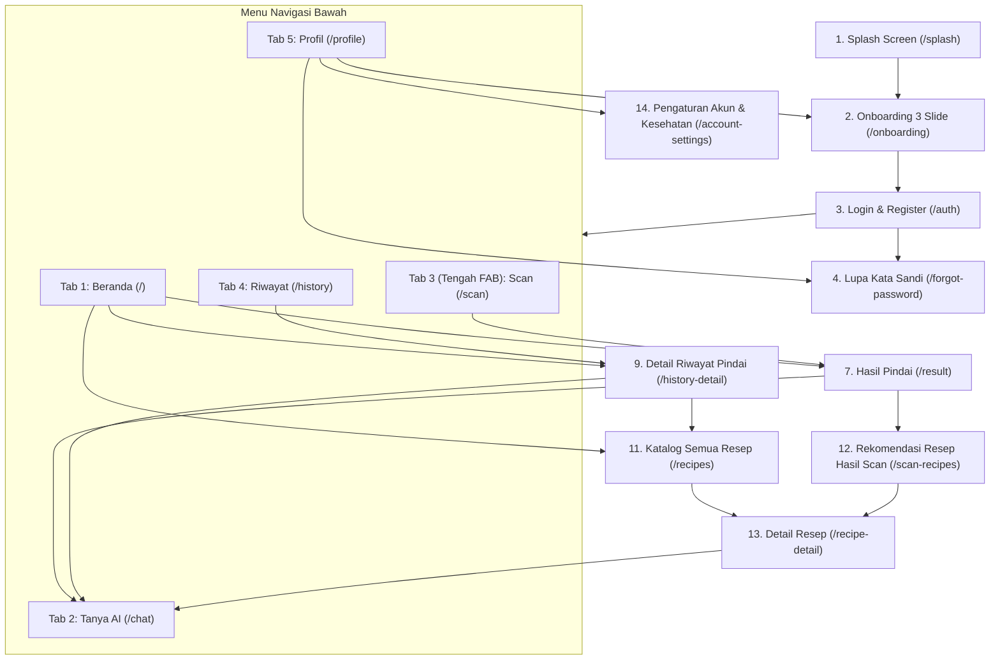

# Daftar Lengkap Fitur, Menu, & Struktur Layar — BananaLens (FruitLens)

> Dokumen referensi lengkap seluruh **menu, layar, komponen UI, modal/bottom sheet, state tampilan, dan alur pengguna** pada aplikasi **BananaLens** sebagai panduan utama untuk **Redesign UI/UX**.

---

## 1. Gambaran Umum Aplikasi

**BananaLens** adalah aplikasi mobile pintar berbasis Flutter untuk:
1. **Memindai pisang secara offline (On-Device AI)** menggunakan kamera atau galeri untuk mendeteksi **4 tingkat kematangan**:
   - **Mentah** (`unripe`)
   - **Matang** (`ripe`)
   - **Matang Banget** (`overripe`)
   - **Busuk** (`rotten`)
2. **Memberikan rekomendasi tindakan cerdas (SPK / Sistem Pendukung Keputusan)** berdasarkan kondisi pisang, rencana waktu pakai, dan tujuan penggunaan.
3. **Menampilkan informasi gizi & keamanan pangan**, termasuk **peringatan alergi otomatis** berdasarkan profil kesehatan pengguna.
4. **Merekomendasikan resep olahan pisang** (baik hasil kreasi Live AI Gemini maupun database resep lokal saat offline).
5. **Menyediakan Asisten Chat AI** kontekstual seputar penyimpanan, keamanan konsumsi, gizi, dan kreasi resep pisang.
6. **Menyimpan riwayat pemindaian** secara lokal (SQLite) dan sinkronisasi akun.

---

## 2. Peta Navigasi & Arsitektur Menu (Sitemap)

---

## 3. Menu Navigasi Utama (Bottom Navigation Bar)

Navigasi bawah terdiri dari **5 item** (otomatis bersembunyi saat keyboard muncul agar tidak menghalangi area ketik chat):

| Posisi | Nama Menu | Rute | Ikon / Bentuk Saat Ini | Fungsi Utama |
| :--- | :--- | :--- | :--- | :--- |
| **Kiri 1** | **Beranda** | `/` | Ikon Rumah (`cottage`) | Dashboard ringkasan statistik, pintasan scan/galeri, riwayat terakhir, resep pilihan, & tips harian. |
| **Kiri 2** | **Tanya AI** | `/chat` | Ikon Bintang AI (`auto_awesome`) | Ruang konsultasi interaktif dengan asisten AI seputar buah, gizi, penyimpanan, dan resep. |
| **Tengah (FAB)** | **Scan / Pindai** | `/scan` | Tombol Bulat Menonjol (`center_focus_strong`) | Membuka kamera pemindai pisang langsung (*viewfinder* + galeri). |
| **Kanan 1** | **Riwayat** | `/history` | Ikon Jam Riwayat (`history`) | Daftar seluruh hasil pindai yang tersimpan lengkap dengan pencarian & filter 4 kelas kematangan. |
| **Kanan 2** | **Profil** | `/profile` | Ikon Pengguna (`person`) | Informasi akun/tamu, ringkasan riwayat, pengaturan kesehatan & alergi, tema tampilan, dan info aplikasi. |

---

## 4. Rincian Detail Setiap Layar (14 Layar)

### 4.1. Splash Screen (`/splash`)
* **Tujuan:** Layar pembuka beranimasi saat aplikasi pertama kali dijalankan.
* **Elemen UI yang Harus Ada:**
  1. Logo / Ikon Scanner BananaLens beranimasi.
  2. Nama aplikasi (**BananaLens**).
  3. Badge/Tag kecil (misal: `ON-DEVICE AI`) & tagline singkat aplikasi.
  4. Indikator progres loading tipis di bagian bawah.
* **Alur Navigasi:** Otomatis berpindah ke `/onboarding` (jika pengguna baru), `/auth` (jika belum login), atau `/` Beranda (jika sudah login).

---

### 4.2. Onboarding / Panduan Penggunaan (`/onboarding`)
* **Tujuan:** Memperkenalkan fitur utama kepada pengguna baru **sekaligus** berfungsi sebagai halaman **Panduan Penggunaan** ketika dibuka ulang dari menu Profil.
* **Elemen UI yang Harus Ada:**
  1. **Header Bar:** Logo + judul (`BananaLens` saat awal, berubah jadi `Panduan Penggunaan` jika diakses pengguna yang sudah login) + tombol **`Lewati`** / **`Tutup`** di kanan atas.
  2. **Carousel 3 Slide Ilustrasi (`PageView`):**
     - **Slide 1 (`PEMINDAI PISANG AI`):** *Deteksi Kematangan Seketika* — Foto pisang dari kamera/galeri secara offline.
     - **Slide 2 (`GIZI & KEAMANAN`):** *Pantau Gizi & Peringatan Alergi* — Informasi kalori, karbohidrat, gula, serat, & deteksi alergi otomatis.
     - **Slide 3 (`RESEP & ASISTEN AI`):** *Ide Resep & Asisten AI* — Rekomendasi olahan sesuai kematangan & chat AI.
  3. **Indikator Halaman (Dots/Bars)** & **Tombol Bawah:**
     - Saat belum login: Tombol **`Lanjut`** → di slide terakhir menjadi **`Mulai Daftar`** + tautan **`Sudah punya akun? Masuk`**.
     - Saat sudah login (mode panduan): Hanya tombol **`Lanjut`** → **`Selesai`**.

---

### 4.3. Autentikasi: Masuk & Daftar (`/auth`)
* **Tujuan:** Halaman masuk (*Login*) dan pendaftaran akun baru (*Register*) dalam satu layar yang dapat berganti mode secara mulus.
* **Elemen UI yang Harus Ada:**
  1. **Header Visual:** Ilustrasi/ikon karakter + judul dinamis (`Masuk ke BananaLens` / `Daftar Akun`) + subjudul.
  2. **Banner Error Validasi/Auth** *(muncul jika email/sandi salah atau email sudah terdaftar)*.
  3. **Form Mode Masuk (Login):**
     - Input `Email`
     - Input `Kata Sandi` (dengan tombol mata *show/hide password*)
     - Tautan **`Lupa kata sandi?`** (kanan bawah input sandi)
     - Tombol utama **`Masuk`** (dengan state loading)
     - Tautan bawah: *Belum punya akun? **Daftar Sekarang***
  4. **Form Mode Daftar (Register):**
     - Input `Nama Lengkap`
     - Input `Email`
     - Input `Kata Sandi` (minimal 6 karakter)
     - Input `Konfirmasi Kata Sandi`
     - Tombol utama **`Buat Akun Sekarang`**
     - Tautan bawah: *Sudah punya akun? **Masuk***
  5. **Overlay Sukses:** Pop-up singkat konfirmasi berhasil masuk/daftar sebelum masuk ke Beranda.

---

### 4.4. Lupa Kata Sandi (`/forgot-password`)
* **Tujuan:** Mengatur ulang kata sandi akun berdasarkan email terdaftar.
* **Elemen UI yang Harus Ada:**
  1. AppBar dengan tombol kembali & judul `Lupa Kata Sandi`.
  2. Ilustrasi kunci/keamanan + judul & instruksi singkat.
  3. Input `Email Terdaftar` (otomatis terisi jika dikirim dari halaman Login atau Profil).
  4. Input `Kata Sandi Baru` + tombol *show/hide*.
  5. Input `Konfirmasi Kata Sandi Baru` + tombol *show/hide*.
  6. Banner error (jika email tidak ditemukan).
  7. Tombol utama **`Simpan Kata Sandi Baru`**.

---

### 4.5. Beranda / Home Dashboard (`/`)
* **Tujuan:** Layar utama tempat pengguna memulai pemindaian dan melihat ringkasan aktivitas.
* **Susunan 6 Blok UI (Atas ke Bawah):**
  1. **Header Sapaan & Profil:**
     - Logo kecil + nama aplikasi `BananaLens`.
     - Sapaan waktu dinamis (`Selamat pagi/siang/sore/malam, <Nama Depan>`).
     - Subjudul singkat (`Pantau kematangan pisang hari ini.`).
     - Avatar inisial nama di kanan atas (diklik menuju `/profile`).
  2. **Hero Card "Pindai Pisang":**
     - Kartu utama paling menonjol dengan ajakan memindai pisang.
     - **2 Tombol CTA langsung:** **`Buka Kamera`** (ke `/scan`) dan **`Pilih Galeri`** (langsung pilih foto → proses scan → `/result`).
  3. **Strip Statistik Cepat (3 Kolom Sejajar):**
     - `Total Pindai` (jumlah seluruh riwayat scan).
     - `Siap Santap` (jumlah pisang `Matang` + `Matang Banget`).
     - `Mentah` (jumlah pisang `Mentah` yang sedang diperam/disimpan).
  4. **Seksi "Riwayat Terakhir":**
     - Header seksi + tombol **`Lihat Semua`** (ke `/history`).
     - Menampilkan maksimal beberapa item scan terakhir lengkap dengan thumbnail foto asli, nama buah, waktu scan, dan badge kematangan (atau *empty state* jika belum pernah scan).
  5. **Seksi "Resep Pilihan" (Horizontal Scroll):**
     - Header seksi + tombol **`Semua Resep`** (ke `/recipes`).
     - Kartu resep geser ke samping berisi ikon visual pisang sesuai kematangan, estimasi waktu masak (`prepTime`), badge tingkat kesulitan (`Mudah`, dll.), judul resep, serta info target kematangan & jumlah bahan.
  6. **Kartu "Tips Hari Ini":**
     - 1 kartu edukasi singkat harian seputar cara menyimpan atau mengolah pisang.

---

### 4.6. Layar Kamera Pindai (`/scan`)
* **Tujuan:** Mengambil foto pisang secara langsung dengan panduan visual yang jelas atau memilih gambar dari galeri.
* **Elemen UI Saat Kamera Aktif:**
  1. **Preview Kamera Fullscreen.**
  2. **Top Bar Overlay:**
     - Tombol **`X` (Tutup)** di kiri atas.
     - Pill petunjuk tengah: **`Arahkan ke buah`**.
     - Tombol **Flash / Senter (`On/Off`)** di kanan atas.
  3. **Area Fokus Tengah:**
     - Bingkai bidik persegi (`220x220`) dengan 4 siku sudut tebal + animasi garis laser pemindai naik-turun.
     - Pill info di bawah bingkai: **`Pastikan pencahayaan cukup`**.
  4. **Bottom Control Bar:**
     - Kiri: Tombol bulat **Galeri** (`Pilih dari Galeri`).
     - Tengah: Tombol besar **Shutter / Ambil Foto**.
     - Kanan: Tombol bulat **Flip Kamera** (depan/belakang).
* **Variasi State Lain yang Wajib Didesain:**
  - **Loading Kamera:** Skeleton bingkai fokus + teks `Menyiapkan kamera…`.
  - **Izin Kamera Ditolak / Permanen Ditolak:** Ikon kamera disilang, penjelasan kenapa butuh kamera, tombol **`Izinkan Kamera`** / **`Buka Pengaturan`**, serta tombol alternatif **`Pilih dari Galeri`**.
  - **Kamera Tidak Tersedia / Error:** Pesan kamera tidak ditemukan + tombol **`Pilih dari Galeri`**.

---

### 4.7. Hasil Pindai (`/result`)
* **Tujuan:** Menampilkan laporan lengkap hasil analisis AI sesaat setelah foto diambil/dipilih.
* **4 State Utama yang Wajib Ada di Desain:**
  1. **State Loading (`Sedang memeriksa foto…`):**
     - Menampilkan foto yang baru diambil dengan efek *sweeping scan laser*, badge `SCANNING // ANALISIS AI`, spinner loading, dan shimmer placeholder di bawahnya.
  2. **State Tidak Yakin / Bukan Pisang (`ScanUncertain`):**
     - Foto tangkapan, badge `DETEKSI // TIDAK YAKIN`, pesan bahwa objek bukan pisang atau foto terlalu buram/gelap, dan tombol **`Foto Ulang`**.
  3. **State Gagal / Error (`ScanFailure`):**
     - Kartu pesan error + tombol **`Coba Lagi`**.
  4. **State Sukses (`ScanSuccess`) — Terdiri dari 4 Blok Utama:**
     - **Blok 1 — Hero Status & Akurasi:**
       - Tag `HASIL // PINDAI`, foto pisang yang dipindai, nama buah (`Pisang`), chip status kematangan berwarna (`Mentah` hijau, `Matang` kuning, `Matang Banget` oranye, `Busuk` merah), serta kotak besar **`XX% Akurasi Kematangan`**.
       - **Banner Peringatan Opsional:**
         - Banner *Low Confidence* jika akurasi `< 60%` (menyarankan foto ulang di tempat terang).
         - **Banner Peringatan Alergi** merah jika pengguna login memiliki alergi `Pisang / Lateks` di profilnya!
       - **Accordion "Lihat rincian skor AI":** Bisa dibuka-tutup untuk melihat progress bar persentase ke-4 kelas (`Mentah`, `Matang`, `Matang Banget`, `Busuk`).
     - **Blok 2 — Kartu Interaktif SPK (Sistem Pendukung Keputusan):**
       - *Jika `Mentah` / `Matang` / `Matang Banget`:*
         - Pilihan chip **`Rencana pakai`:** `Hari ini` | `2–3 hari` | `> 4 hari` *(opsi disesuaikan otomatis per kondisi)*.
         - Pilihan chip **`Tujuan`:** `Konsumsi` | `Jual` | `Olahan` *(opsi disesuaikan otomatis per kondisi)*.
         - Hasil Keputusan SPK instan (4 kemungkinan kelas keputusan: *Simpan & Distribusi*, *Konsumsi & Jual Segar*, *Segera Olah*, atau *Buang / Kompos*), lengkap dengan deskripsi alasan, kotak tips tindakan, dan tombol **`Rekomendasi Resep`** (menuju `/scan-recipes`).
       - *Jika `Busuk`:*
         - Pilihan chip dikunci/disembunyikan otomatis → tampil kartu merah **`Tidak Layak Konsumsi / Daur Ulang Kompos`** + tombol **`Tips Daur Ulang`** (membuka bottom sheet panduan kompos/eco-enzyme).
     - **Blok 3 — Ringkasan Nutrisi & Manfaat:**
       - Banner energi utama: **`89 kkal · Kalori | Per 100 g`**.
       - 3 kotak makro sejajar: **`Karbohidrat (22.8 g)`**, **`Gula Alami (12.2 g)`**, **`Serat Pangan (2.6 g)`**.
       - Kartu manfaat kesehatan & vitamin.
     - **Blok 4 — Tombol Aksi Bawah:**
       - Tombol utama **`Simpan ke Riwayat`** (berubah jadi `Tersimpan` dengan ikon centang setelah diklik; catatan: riwayat juga otomatis tercatat).
       - Tombol sekunder **`Tanya AI`** (membuka `/chat` dengan konteks hasil pindai sudah terpasang otomatis).

---

### 4.8. Riwayat Scan (`/history`)
* **Tujuan:** Melihat, mencari, menyaring, dan mengelola semua rekaman pemindaian sebelumnya.
* **Elemen UI yang Harus Ada:**
  1. **AppBar:** Ikon & judul `Riwayat Scan`.
  2. **Search Bar:** Input pencarian (`Cari: Mentah, Matang, Matang Banget, Busuk...`) + tombol silang (`X`) penghapus teks.
  3. **Baris Filter Chip Horizontal (5 Chip):**
     - `Semua` | `Mentah` | `Matang` | `Matang Banget` | `Busuk`
  4. **Penghitung Hasil:** Teks kecil `N hasil pindai`.
  5. **Daftar Kartu Item Riwayat:**
     - Thumbnail foto scan asli, judul `Pisang`, waktu relatif/tanggal (`Hari ini, 14:20` / `Kemarin`), persentase keyakinan (`XX% yakin`), chip warna status kematangan, dan tombol ikon **Hapus (tempat sampah)**.
  6. **Variasi State:**
     - *Loading:* Shimmer skeleton.
     - *Kosong sama sekali:* Ilustrasi kosong + tombol **`Mulai Pindai Sekarang`**.
     - *Hasil filter/pencarian kosong:* Pesan `Tidak Ditemukan`.

---

### 4.9. Detail Riwayat Pindai (`/history-detail`)
* **Tujuan:** Menampilkan kembali detail rekaman pindai terdahulu beserta panduan konsumsi/penyimpanan dan akses cepat ke resep atau AI.
* **Elemen UI yang Harus Ada:**
  1. **AppBar:** Tombol kembali + judul `Detail Riwayat Pindai`.
  2. **Hero Card Catatan Pindai:**
     - Tag `CATATAN // PINDAI` + tanggal & jam pemindaian di kanan atas.
     - Foto hasil pindai dengan tombol *overlay* **`Perbesar`** di pojok kanan bawah foto (membuka *fullscreen pinch-to-zoom*).
     - Nama buah (`Pisang`) + chip status kematangan.
     - Kotak **`XX% Akurasi Kematangan`** dengan label kecil `Ketuk untuk rincian` (diklik membuka bottom sheet estimasi distribusi 4 kelas).
  3. **Blok Nutrisi:**
     - Banner `89 kkal · Kalori | Per 100 g` + 3 kartu sejajar (`Karbohidrat`, `Gula Alami`, `Serat Pangan`).
  4. **Kartu Panduan Sadar Kematangan:**
     - *Jika layak konsumsi (`Mentah` / `Matang` / `Matang Banget`):* Seksi **`SARAN KONSUMSI`** & **`DAYA SIMPAN`** yang isinya menyesuaikan tingkat kematangan.
     - *Jika `Busuk`:* Kartu merah **`PERINGATAN KEAMANAN PANGAN`** & **`SARAN PENANGANAN`** (kompos organik / eco-enzyme).
  5. **Bottom Action Bar (Sticky di Bawah):**
     - Tombol kiri: **`Resep`** (ke `/recipes` terfilter kematangan) **ATAU** **`Daur Ulang`** (jika busuk, membuka sheet panduan daur ulang).
     - Tombol kanan: **`Tanya AI`** (ke `/chat` dengan membawa konteks riwayat pindai tersebut).

---

### 4.10. Asisten Chat AI (`/chat`)
* **Tujuan:** Konsultasi tanya-jawab interaktif dengan AI seputar buah pisang, penyimpanan, keamanan pangan, dan ide olahan.
* **Elemen UI yang Harus Ada:**
  1. **AppBar Khusus Chat:**
     - Ikon AI + judul `Asisten Buah AI` + indikator titik hijau `ONLINE // AI`.
     - Tombol aksi kanan 1: **Riwayat Chat** (membuka bottom sheet daftar sesi percakapan sebelumnya).
     - Tombol aksi kanan 2: **Chat Baru** (menyimpan sesi aktif & memulai obrolan bersih).
  2. **Banner Konteks Pindai Aktif *(Kondisional)*:**
     - Muncul di bawah AppBar jika pengguna masuk ke Chat dari halaman Hasil Pindai atau Detail Riwayat (contoh: `KONTEKS PINDAI AKTIF: Pisang (Matang · 89% keyakinan)`), dilengkapi tombol **`X`** untuk melepas konteks.
  3. **Area Daftar Pesan (Chat Bubbles):**
     - Gelembung pesan AI (mendukung format Markdown: tebal, daftar poin, penomoran) & gelembung pesan pengguna.
     - Indikator animasi mengetik (*3 titik bergerak*) saat menunggu balasan AI.
     - Gelembung pesan error merah jika koneksi gagal.
  4. **Baris Chip Pertanyaan Cepat (Horizontal Scroll di atas input):**
     - Berubah dinamis! Jika ada konteks scan aktif, menampilkan saran kontekstual (*"Apakah pisang ini masih aman dikonsumsi?"*, *"Ide olahan yang cocok untuk kondisi ini?"*, dll.). Jika tanpa konteks, menampilkan pertanyaan umum pisang.
  5. **Bar Input Pesan Bawah:**
     - Kolom teks `Tanyakan seputar buah...` + tombol **Kirim (`Send`)**.

---

### 4.11. Katalog Semua Resep Olahan (`/recipes`)
* **Tujuan:** Menjelajahi koleksi resep sehat berbahan pisang berdasarkan tingkat kematangan atau jenis sajian.
* **Elemen UI yang Harus Ada:**
  1. **AppBar:** Judul `Semua Resep Olahan` (atau `Resep Olahan Pisang` jika dibuka dari riwayat) + subjudul.
  2. **Hero Banner Kuliner:** Kartu pengantar `KREASI SEHAT ALAMI — Optimalkan Nutrisi Pisangmu`.
  3. **Filter Chip Kategori (6 Chip Horizontal):**
     - `Semua` | `Mentah` | `Matang` | `Matang Banget` | `Makanan` | `Minuman`
  4. **Daftar Kartu Resep:**
     - Ikon visual pisang sesuai kematangan, judul resep, durasi pembuatan (`prepTime`), tingkat kesulitan (`difficulty`), tag kecocokan (`Cocok: Matang`, dll.), serta **badge merah peringatan alergi** jika bahan resep mengandung alergen yang dicatat pengguna di profil!
  5. **Banner CTA Bawah "Mau Resep Kustom? Tanya AI":**
     - Mengirim prompt otomatis ke halaman `/chat` sesuai filter yang sedang aktif.

---

### 4.12. Rekomendasi Resep Hasil Scan (`/scan-recipes`)
* **Tujuan:** Halaman khusus yang terbuka dari tombol **Rekomendasi Resep** di Hasil Pindai, menggabungkan resep kreasi **Live AI Gemini** di bagian atas dan **Resep Pilihan Offline** di bagian bawah.
* **Elemen UI yang Harus Ada:**
  1. **AppBar:** Judul `Rekomendasi Resep Pisang`, subjudul `<Status Kematangan> · Keyakinan XX%`, dan tombol ikon **Refresh** (`Buat Variasi AI Baru`) di kanan atas.
  2. **Filter Chip Preferensi Sajian (6 Chip Horizontal):**
     - `Semua` | `Makanan` | `Minuman` | `Manis` | `Gurih` | `Praktis`
  3. **Banner Status Sumber Resep:**
     - Menjelaskan apakah resep sedang dibuat khusus oleh Live AI atau sedang menampilkan resep offline (saat tanpa internet / kuota habis).
  4. **Seksi 1 — "Ide Resep Spesial AI":** Daftar kartu resep dengan badge khusus **`AI`**.
  5. **Seksi 2 — "Resep Pilihan Lainnya / Offline":** Daftar kartu resep kurasi lokal sebagai pendamping/cadangan.

---

### 4.13. Detail Resep (`/recipe-detail`)
* **Tujuan:** Panduan memasak langkah demi langkah yang nyaman dibaca sambil menyiapkan bahan.
* **Elemen UI yang Harus Ada:**
  1. **AppBar:** Judul nama resep + subjudul.
  2. **Kartu Ringkasan Metrik (3 Kolom):**
     - `Waktu Masak` | `Kesulitan` | `Jenis Buah & Target Kematangan (Makanan/Minuman · Mentah/Matang/Matang Banget)`.
  3. **Kartu Catatan Keamanan Pengolahan *(Kondisional)*:**
     - Muncul jika resep memiliki catatan keamanan khusus (`safetyNotes`).
  4. **Seksi "Bahan-bahan yang Dibutuhkan" (Checklist Interaktif):**
     - Daftar bahan dengan kotak centang (*checkbox*) yang bisa diketuk satu per satu; bahan yang sudah dicentang otomatis tercoret (*strikethrough*).
  5. **Seksi "Langkah Pembuatan":**
     - Daftar kartu bernomor urut (`1`, `2`, `3`, dst.) berisi instruksi memasak.
  6. **Kartu "Tips Nutrisi Segar":** Tips singkat menjaga kandungan gizi olahan.
  7. **Tombol Aksi Bawah:**
     - Tombol utama **`Tanya AI Modifikasi Resep`** (membuka `/chat` dan langsung meminta ide substitusi bahan yang lebih sehat/rendah kalori untuk resep tersebut).
     - Tombol sekunder **`Kembali ke Daftar Resep`**.

---

### 4.14. Profil Saya (`/profile`) & Pengaturan Akun (`/account-settings`)

#### A. Halaman Profil Saya (`/profile`)
* **Kartu Header Profil (2 Mode State):**
  - **Mode Tamu (Belum Login):** Tag `MODE TAMU // OFFLINE`, info belum masuk akun, tombol **`Masuk`**, tombol **`Daftar`**, dan tombol cepat **`Coba Akun Demo (1-Klik)`**.
  - **Mode Login (Akun Aktif):** Tag `AKUN AKTIF`, avatar inisial nama, nama lengkap, email, serta badge ringkasan: `Tujuan Kesehatan`, `Jumlah Alergi`, dan `Usia`.
* **Kartu Ringkasan Riwayat Pemindaian:**
  - Menampilkan total jumlah scan, tombol **`Lihat Semua`** (ke `/history`), dan preview **2 riwayat pindai terbaru** (atau tombol `Mulai Pindai` jika masih kosong).
* **Grup Menu 1 — "Pengaturan Akun":**
  1. **Profil & Preferensi Kesehatan** → menuju `/account-settings` (atau `/auth` jika belum login).
  2. **Keamanan & Kata Sandi** → menuju `/forgot-password`.
  3. **Keluar dari Akun** *(hanya muncul jika sudah login, warna merah destruktif)* → memunculkan dialog konfirmasi keluar.
* **Grup Menu 2 — "Pengaturan" (Aplikasi):**
  1. **Tema & Tampilan** → membuka bottom sheet pemilih tema (`Ikuti Sistem`, `Terang`, `Gelap`).
  2. **Engine AI On-Device** → membuka modal spesifikasi teknis model AI offline.
  3. **Panduan Penggunaan** → membuka ulang slide panduan (`/onboarding`).
  4. **Tentang BananaLens** → membuka modal informasi versi & privasi aplikasi.

#### B. Halaman Pengaturan Akun & Kesehatan (`/account-settings`)
* **Banner Identitas Akun:** Menampilkan avatar, nama, dan email akun aktif.
* **Kartu Form Data Diri:**
  - Input `Nama Lengkap`
  - Input `Usia (th)` & `Berat Badan (kg)` (2 kolom sejajar).
* **Kartu Pilihan "Tujuan Kesehatan" (Single-Select Radio Cards — 3 Opsi):**
  1. `Pola Hidup Sehat` (*Keseimbangan vitamin & antioksidan harian*)
  2. `Diet & Defisit Kalori` (*Prioritas buah rendah gula & tinggi serat*)
  3. `Bulking & Massa Otot` (*Asupan energi padat untuk pemulihan*)
* **Kartu Pilihan "Peringatan Alergi Buah" (Multi-Select Checkbox Cards — 5 Opsi):**
  1. `Pisang / Lateks`
  2. `Susu / Laktosa`
  3. `Kacang-kacangan`
  4. `Gluten / Tepung`
  5. `Telur`
* **Tile Pintasan Ubah Kata Sandi** (menuju `/forgot-password`).
* **Sticky Bottom Bar:** Tombol **`Simpan Perubahan`**.

---

## 5. Daftar Seluruh Pop-Up, Modal, & Bottom Sheet

Jangan lupa menyiapkan desain komponen *overlay* berikut agar konsisten dengan layar utama:

1. **Bottom Sheet: Panduan Penanganan Buah Busuk (`showRottenGuidanceSheet`)**
   - Muncul dari Hasil Pindai & Detail Riwayat saat pisang berstatus `Busuk`. Berisi langkah aman membuang/mengolah limbah pisang menjadi kompos atau *eco-enzyme* + tombol `Saya Mengerti`.
2. **Bottom Sheet: Rincian Skor Akurasi 4-Kelas (`showHistoryConfidenceBreakdownSheet`)**
   - Muncul saat mengetuk kotak `% Akurasi` di Detail Riwayat Pindai. Menampilkan bar persentase `Mentah`, `Matang`, `Matang Banget`, dan `Busuk` dengan badge `TERDETEKSI`.
3. **Fullscreen Image Viewer (`showHistoryFullscreenImage`)**
   - Dialog layar penuh berlatar gelap untuk memperbesar (*pinch-to-zoom*) foto hasil pindai + tombol tutup (`X`).
4. **Bottom Sheet: Riwayat Percakapan Chat AI (`ChatHistorySheet`)**
   - Menampilkan daftar sesi chat tersimpan (judul otomatis, jumlah pertanyaan, waktu terakhir, badge `AKTIF`), tombol `+ Chat Baru`, tombol hapus per sesi, dan tombol `Hapus Semua`.
5. **Bottom Sheet: Pemilih Tema & Tampilan (`ThemePickerSheet`)**
   - 3 pilihan kartu radio: `Ikuti Sistem`, `Fresh Harvest (Terang)`, dan `Night Harvest (Gelap)`.
6. **Dialog Konfirmasi Aksi Destruktif (3 Variasi Seragam):**
   - Konfirmasi **Hapus 1 Item Riwayat Scan**.
   - Konfirmasi **Hapus Sesi / Semua Riwayat Chat**.
   - Konfirmasi **Keluar dari Akun (Logout)**.
7. **Dialog Informasi Aplikasi & Spesifikasi Engine AI (`ProfileScreen` Modals):**
   - Modal **Engine AI On-Device** (spesifikasi ML Kit, MobileNetV3 + HSV, PCA + RBF SVM, 100% Offline Isolate).
   - Modal **Tentang BananaLens** (versi aplikasi & deskripsi privasi lokal).

---

## 6. Sistem Warna Semantik & Catatan Penting untuk Redesign

Saat merancang tampilan baru, pastikan sistem desain memiliki **4 warna status semantik kematangan** yang jelas dan mudah dibedakan (baik di mode Terang maupun Gelap):

| Status Kematangan | Kode Kelas | Makna Visual yang Disarankan | Contoh Penggunaan di UI |
| :--- | :--- | :--- | :--- |
| **Mentah** | `unripe` | Hijau segar / daun | Chip status, kotak akurasi, bar skor AI, filter riwayat |
| **Matang** | `ripe` | Kuning pisang cerah | Chip status, kotak akurasi, aksen utama aplikasi |
| **Matang Banget** | `overripe` | Oranye hangat / amber | Chip status, kotak akurasi, catatan olahan cepat |
| **Busuk** | `rotten` | Merah peringatan (*danger*) | Chip status, kartu keamanan pangan, peringatan alergi |

### Checklist Wajib Saat Meredesain:
- [ ] Mendukung **Light Mode** dan **Dark Mode**.
- [ ] Semua halaman yang memuat data memiliki desain untuk **4 state**: *Loading (Skeleton/Shimmer)*, *Empty (Kosong)*, *Error (Gagal)*, dan *Success (Berisi Data)*.
- [ ] Ukuran area sentuh (*touch target*) tombol, chip filter, dan ikon minimal **44–48 dp** agar nyaman diketuk ibu jari.
- [ ] Navigasi bawah tetap nyaman dan tidak bertabrakan dengan *input bar* pada halaman **Tanya AI**.
