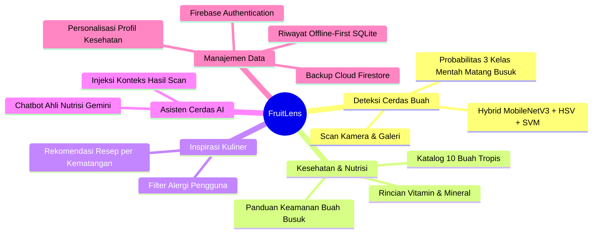
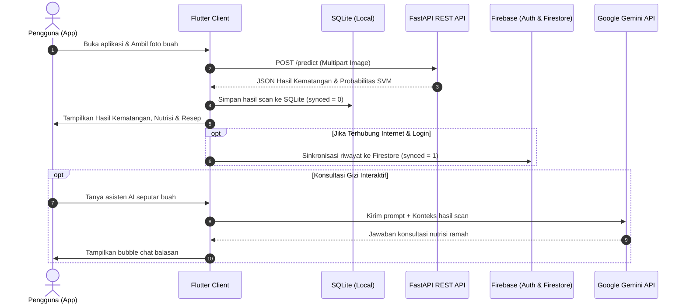
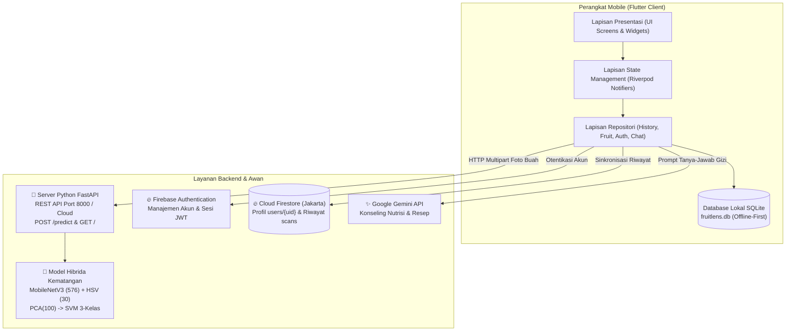
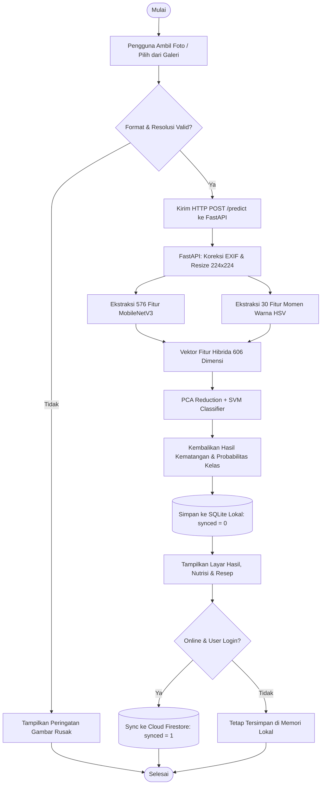
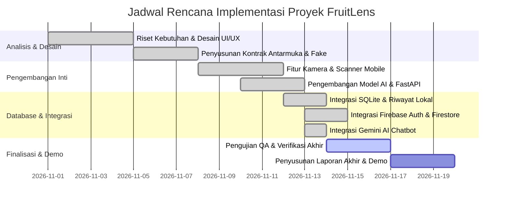

# PROPOSAL PROYEK AKHIR PEMROGRAMAN MOBILE 2

**Judul Proyek:**  
**FruitLens: Aplikasi Mobile Cerdas Pemantau Kematangan Buah dan Rekomendasi Nutrisi Berbasis Computer Vision & LLM**

---

## 1. Judul dan Identitas Proyek

### 1.1 Identitas Proyek & Kelompok

| Komponen | Keterangan |
|---|---|
| **Mata Kuliah** | Pemrograman Mobile 2 |
| **Judul Proyek** | FruitLens — Smart Fruit Ripeness Scanner & Nutrition Assistant |
| **Platform Sasaran** | Android (Minimum SDK 26 / Android 8.0 Oreo ke atas) |
| **Repositori & Kode** | Flutter (Dart), Python FastAPI, Firebase BaaS |

### 1.2 Anggota Kelompok

| No. | Nama Mahasiswa | NIM | Peran Utama dalam Tim |
|:---:|---|:---:|---|
| 1. | **[Nama Anda]** | [NIM 1] | **Mobile Lead & UI/UX Engineer** (Flutter, Riverpod, Local DB SQLite, Clean Architecture) |
| 2. | **[Nama Rekan 1]** | [NIM 2] | **AI & Computer Vision Engineer** (Dataset, Feature Extractor MobileNetV3, SVM Classifier, REST API FastAPI) |
| 3. | **[Nama Rekan 2]** *(Opsional)* | [NIM 3] | **DevOps, Data Ops & QA Engineer** (Firebase Setup, Cloud Deployment, Kurasi Data Nutrisi, Pengujian Lintas Perangkat) |

### 1.3 Deskripsi Singkat Aplikasi
**FruitLens** adalah aplikasi mobile berbasis Flutter yang mengintegrasikan teknologi **Computer Vision (Machine Learning)** dan **Large Language Model (LLM)** untuk membantu pengguna mengenali tingkat kematangan buah secara instan melalui kamera ponsel. Aplikasi mampu mengklasifikasikan kondisi kematangan (khususnya buah pisang menjadi kategori *Mentah*, *Matang*, dan *Busuk*) dengan model **Hybrid MobileNetV3Small + Analisis Warna HSV + Support Vector Machine (SVM)** berakurasi 96%. 

Selain deteksi visual, FruitLens menyediakan rekomendasi gizi berbasis sains, panduan keamanan pangan kontekstual (peringatan bahaya mikotoksin untuk buah busuk), ide resep masakan berbasis kematangan, serta asisten tanya-jawab interaktif berbasis **Google Gemini AI**. Seluruh riwayat pemindaian dirancang dengan pendekatan **Offline-First (SQLite)** dan tersinkronisasi otomatis ke **Cloud Firestore & Firebase Authentication**.

---

## 2. Latar Belakang dan Permasalahan

### 2.1 Permasalahan yang Ingin Diselesaikan
1. **Tingginya Angka Pemborosan Pangan (*Food Waste*) Rumah Tangga**:  
   Buah-buahan tropis seperti pisang memiliki laju respirasi klimakterik yang sangat cepat. Masyarakat kerap terlambat mengonsumsi atau mengolah buah sehingga buah keburu membusuk dan terbuang sia-sia.
2. **Keterbatasan Evaluasi Visual Subjektif**:  
   Banyak konsumen kesulitan membedakan antara buah yang baru mulai matang, matang sempurna untuk konsumsi langsung, atau yang telah mengalami pembusukan internal tersembunyi hanya dari pengamatan kasat mata.
3. **Risiko Kesehatan Akibat Konsumsi Buah Busuk**:  
   Buah yang membusuk berisiko mengandung spora jamur (*fungal contamination*) dan mikotoksin yang berbahaya bila tetap dikonsumsi, sementara masyarakat sering kali minim informasi mengenai standar keamanan pangan buah.
4. **Ketiadaan Solusi Terintegrasi yang Praktis**:  
   Aplikasi yang ada di pasar umumnya hanya berupa pemindai kalori umum atau ensiklopedia statis yang tidak mampu mendeteksi kondisi fisik buah pengguna secara langsung lewat kamera.

### 2.2 Alasan Aplikasi Perlu Dikembangkan
FruitLens hadir sebagai asisten digital harian yang menjembatani sains pangan dan teknologi kecerdasan buatan dalam genggaman. Dengan memberikan deteksi akurat seketika, informasi nutrisi terverifikasi, dan ide pengolahan kuliner kontekstual, aplikasi ini secara aktif menekan angka pemborosan pangan rumah tangga, menghemat pengeluaran belanja, dan menjaga kesehatan keluarga.

### 2.3 Target Pengguna Aplikasi
- **Ibu Rumah Tangga & Pengelola Dapur**: Membantu perencanaan konsumsi dan pengolahan bahan makanan sebelum membusuk.
- **Penggiat Gaya Hidup Sehat & Diet**: Memantau kandungan gula dan vitamin alami buah sesuai tingkat kematangannya.
- **Pedagang Buah & Pengusaha Kuliner Mikro**: Memilah stok buah secara cepat dan konsisten saat penyortiran.

---

## 3. Tujuan dan Fitur Aplikasi

### 3.1 Tujuan Pengembangan Aplikasi
1. Membangun aplikasi mobile Android yang andal, responsif, dan mudah digunakan menggunakan framework Flutter dan Clean Architecture.
2. Mengintegrasikan model Machine Learning hibrida (MobileNetV3 + HSV + SVM) melalui REST API FastAPI untuk klasifikasi kematangan buah secara *real-time*.
3. Menyediakan asisten virtual berbasis LLM (Google Gemini) yang mampu memberikan konsultasi gizi dan ide resep interaktif.
4. Menerapkan arsitektur data *Offline-First* yang tangguh dengan SQLite lokal serta sinkronisasi aman ke Cloud Firestore dan Firebase Auth.

### 3.2 Daftar Fitur Utama

1. **Pemindaian Kematangan Buah Instan (*Smart Ripeness Scanner*)**:  
   Pengguna dapat mengambil foto buah via kamera langsung atau memilih dari galeri. Citra diproses untuk memprediksi tingkat kematangan (*Mentah*, *Matang*, *Busuk*) lengkap dengan persentase keyakinan (*confidence level*) dan grafik batang probabilitas kelas.
2. **Kartu Peringatan Keamanan Pangan (*Food Safety & Rotten Guidance*)**:  
   Secara kontekstual menampilkan kartu waspada bahaya mikotoksin bila buah terdeteksi busuk, mengganti tombol resep menjadi panduan pembuatan pupuk kompos/daur ulang organik.
3. **Katalog Nutrisi & Fakta Gizi**:  
   Informasi komprehensif mengenai kalori, karbohidrat, serat, vitamin C, dan kalium untuk 10 jenis buah konsumsi populer.
4. **Rekomendasi Resep Cerdas (*Smart Recipe Suggestions*)**:  
   Rekomendasi resep kuliner yang disaring otomatis berdasarkan tingkat kematangan buah dan preferensi alergi pengguna (misal: pisang matang untuk *Banana Smoothie*, pisang terlalu matang untuk *Bolu Pisang Kukus*).
5. **Asisten Gizi Cerdas (*FruitLens AI Assistant*)**:  
   Chatbot interaktif berbasis Gemini LLM yang dapat diajak berdiskusi tentang manfaat buah, panduan konsumsi untuk penderita diabetes/asam lambung, dan kreasi resep baru.
6. **Riwayat Pemindaian *Offline-First***:  
   Menyimpan seluruh catatan scan pengguna di memori perangkat lokal (SQLite) sehingga riwayat dapat dilihat kapan pun tanpa internet.
7. **Sinkronisasi Awan & Autentikasi Pengguna**:  
   Otentikasi aman menggunakan Firebase Auth (email & password) dan pencadangan otomatis profil serta riwayat pemindaian ke Cloud Firestore saat perangkat terhubung internet.

### 3.3 Gambaran Alur Penggunaan Aplikasi (User Flow)

---

## 4. Rancangan Teknologi

| Komponen Arsitektur | Teknologi Terpilih | Justifikasi & Alasan Pemilihan |
|---|---|---|
| **Mobile Framework** | **Flutter 3 (Dart 3.x)** | Pengembangan lintas platform berkinerja tinggi, rendering UI 60fps dengan Material 3, serta dukungan ekosistem paket yang matang. |
| **State Management** | **Flutter Riverpod 3.x** | *Compile-time safe*, modular, mudah diuji (*testable*), menghindari kebocoran memori, dan memisahkan logika bisnis dari UI. |
| **Pola Desain Klien** | **Clean Architecture** | Membagi kode ke dalam lapisan *Presentation (UI/Notifier)*, *Domain/Repository*, dan *Data Source* demi kemudahan pemeliharaan dan pengujian. |
| **AI Microservice (BE)** | **Python FastAPI + Uvicorn** | Ekosistem native terbaik untuk komputasi tensor Machine Learning, performa asinkron sangat cepat, dan dokumentasi interaktif otomatis di `/docs`. |
| **Computer Vision / ML** | **MobileNetV3Small + HSV + PCA + SVM** | Model hibrida menggabungkan ekstraksi *deep spatial features* (576 dimensi) dan histogram warna (30 dimensi) menghasilkan akurasi tinggi (96%) dengan latensi inferensi rendah (~200ms). |
| **Large Language Model** | **Google Gemini Generative AI API** | Menyediakan asisten gizi kontekstual cerdas dalam Bahasa Indonesia yang lancar dan ramah. |
| **Database Lokal** | **SQLite (`sqflite`)** | Menjamin kapabilitas *Offline-First*; riwayat pemindaian dan data buah lokal dapat diakses seketika tanpa koneksi data. |
| **Backend-as-a-Service** | **Firebase Auth & Cloud Firestore** | Standar industri untuk otentikasi aman token JWT, basis data NoSQL awan terskala otomatis, serta dashboard visual manajemen data bagi tim operasional. |

---

## 5. Rancangan Arsitektur dan Alur Sistem

### 5.1 Gambaran Arsitektur Sistem (Hybrid Client-Server)

### 5.2 Flowchart Alur Sistem Pemindaian

### 5.3 Rancangan Database

#### A. Database Lokal SQLite (`fruitlens.db`)
Tabel utama `scan_results`:
| Nama Kolom | Tipe Data | Keterangan |
|---|---|---|
| `id` | `INTEGER PRIMARY KEY AUTOINCREMENT` | ID unik penomoran riwayat lokal |
| `image_path` | `TEXT NOT NULL` | Lokasi file gambar di memori perangkat |
| `fruit_label` | `TEXT NOT NULL` | Label komoditas buah (misal: `banana`) |
| `ripeness_label`| `TEXT NOT NULL` | Label kematangan (`Mentah`, `Matang`, `Busuk`) |
| `confidence` | `REAL NOT NULL` | Akurasi keyakinan kematangan (0.0 – 100.0) |
| `created_at` | `TEXT NOT NULL` | Format ISO8601 waktu pemindaian |
| `is_favorite` | `INTEGER DEFAULT 0` | Penanda favorit pengguna (0 / 1) |
| `synced` | `INTEGER DEFAULT 0` | Penanda status sinkronisasi ke cloud (0 / 1) |

#### B. Database Awan NoSQL (Cloud Firestore)
1. **Koleksi `users/{uid}`**: Menyimpan data profil (email, nama lengkap, usia, berat badan, tujuan pola hidup, dan daftar alergi buah).
2. **Sub-koleksi `users/{uid}/scans/{scanId}`**: Menyimpan salinan awan hasil scan pengguna untuk pencadangan riwayat.

---

## 6. Rencana Implementasi

### 6.1 Tahapan Pengembangan Aplikasi

### 6.2 Pembagian Tugas Masing-Masing Anggota Kelompok

1. **[Nama Anda] — Mobile Lead & UI/UX Engineer**:
   - Merancang tata letak dan hierarki antarmuka aplikasi dengan token desain Material 3 (*Fresh Harvest* & *Night Harvest Theme*).
   - Mengimplementasikan seluruh layar (Beranda, Kamera Scan, Hasil Scan, Riwayat, Chatbot, Resep, dan Profil).
   - Membangun *State Management* Riverpod dan arsitektur repositori lokal SQLite (*Offline-First*).
   - Menghubungkan komunikasi HTTP multipart antara Flutter dan backend AI.

2. **[Nama Rekan 1] — AI & Computer Vision Engineer**:
   - Mengumpulkan dataset buah pisang dalam berbagai variasi kondisi pencahayaan dan latar belakang.
   - Melatih model Machine Learning Hybrid: ekstraksi MobileNetV3Small (576 fitur) + 30 fitur warna HSV, normalisasi PCA, dan klasifikasi SVM.
   - Membangun microservice Python FastAPI (`main.py`) dengan endpoint `GET /` dan `POST /predict`.
   - Menguji akurasi prediksi model dan menyusun dokumentasi Swagger API di `/docs`.

3. **[Nama Rekan 2] — DevOps, Data Ops & QA Engineer**:
   - Mengonfigurasi proyek Firebase Console, mengaktifkan Firebase Authentication dan Cloud Firestore database.
   - Melakukan kurasi data kandungan gizi 10 buah dan resep kuliner Indonesia ke format data terstruktur.
   - Menyiapkan kontainerisasi server (`Dockerfile`) dan pengujian kinerja API.
   - Menjalankan pengujian otomatis unit/widget test dan uji kompatibilitas lintas perangkat Android.

### 6.3 Target Hasil Akhir yang Ingin Dicapai
- [x] Aplikasi mobile Flutter berjalan mulus di perangkat Android (Android 8.0 s/d 14+) tanpa *lag* (60 fps).
- [x] Model AI mampu mengklasifikasikan kematangan buah pisang dengan akurasi teruji 96% dalam waktu respon < 1 detik.
- [x] Seluruh alur offline-first terbukti berjalan: pemindaian tetap tercatat di SQLite lokal saat tanpa internet, dan otomatis terunggah ke Cloud Firestore saat online.
- [x] Fitur chatbot nutrisi Gemini mampu menjawab pertanyaan pengguna seputar kesehatan buah dalam Bahasa Indonesia secara santun dan akurat.
- [x] Kode bersih dan lulus 100% verifikasi (`flutter analyze` 0 warning/error dan seluruh rangkaian pengujian otomatis lulus).

