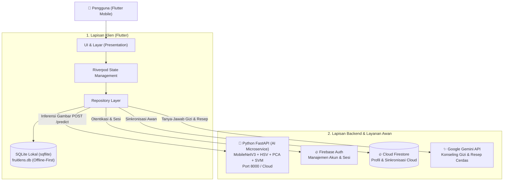
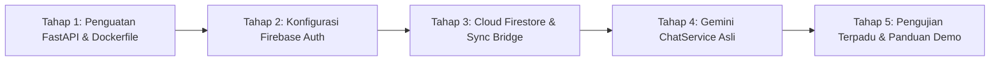

# Rencana Pengembangan Backend & Database — FruitLens

> **Status:** Disetujui Dosen Pemrograman Mobile 2 (Zoom Session)  
> **Target:** Memenuhi Rubrik Penilaian Proyek Akhir & Siap Demo  
> **Arsitektur:** Hybrid Architecture (FastAPI Python AI + Firebase BaaS + SQLite Offline-First)

---

## 1. Ringkasan Eksekutif & Keselarasan

Dalam pengembangan aplikasi **FruitLens**, arsitektur Backend (BE) dan Database (DB) dirancang dengan pendekatan **Hybrid Client-Server & BaaS (Backend-as-a-Service)**:



### Mengapa Pendekatan Ini Terbaik untuk FruitLens?
1. **Model Machine Learning Memerlukan Python**: Model klasifikasi kematangan pisang kita (Hybrid MobileNetV3 + HSV + PCA + SVM) dibangun dengan Scikit-Learn dan TensorFlow. Menjalankannya via **Python FastAPI** adalah pilihan paling native, cepat, dan akurat tanpa hambatan konversi format model.
2. **Otentikasi & Cloud DB Cepat & Andal via Firebase**: Menghindari pembuatan sistem autentikasi manual yang rentan celah keamanan. Firebase Auth dan Firestore menangani token JWT, validasi email, dan persistensi sesi pengguna secara standar industri.
3. **Offline-First via SQLite**: Pengguna tetap dapat melihat riwayat scan, membaca nutrisi buah, dan menjelajahi resep meskipun berada di kebun atau area tanpa sinyal internet.
4. **Sesuai Rubrik Pemrograman Mobile 2**: Memenuhi seluruh kriteria: Flutter Client, Clean Architecture, REST API, Database Lokal/Awan, dan integrasi AI/Computer Vision.

---

## 2. Rincian Komponen 1: Python FastAPI (AI Backend Service)

### 2.1 Peran & Tanggung Jawab
- Menjadi **REST API server** yang menerima unggahan foto buah dari aplikasi Flutter.
- Melakukan pemrosesan citra (koreksi rotasi EXIF, resize `224x224`, normalisasi warna).
- Mengekstrak **576 fitur deep features** (MobileNetV3Small) + **30 fitur warna HSV**.
- Menjalankan inferensi model Scikit-Learn (PCA + SVM 3-kelas: *Mentah*, *Matang*, *Busuk*).
- Mengembalikan hasil klasifikasi, keyakinan (*confidence*), dan rincian probabilitas dalam format JSON.

### 2.2 Spesifikasi Endpoint REST API

#### A. Health Check & Informasi Model
- **Method / URL**: `GET /`
- **Tujuan**: Memeriksa status server dan memverifikasi model SVM yang sedang aktif.
- **Respons (200 OK)**:
```json
{
  "status": "Server Aktif",
  "service": "FruitLens AI Backend",
  "fruit": "banana",
  "model": "Hybrid MobileNetV3Small (576) + HSV (30) -> PCA + SVM",
  "model_file": "svm_pisang_3kelas(96%).pkl",
  "classes": ["unripe", "ripe", "rotten"]
}
```

#### B. Prediksi Kematangan Buah
- **Method / URL**: `POST /predict`
- **Content-Type**: `multipart/form-data`
- **Payload**: `file` (Binary Image: JPG/PNG)
- **Respons Sukses (200 OK)**:
```json
{
  "status": "success",
  "fruit_label": "banana",
  "prediction": "Matang",
  "raw_class": "ripe",
  "confidence": 98.45,
  "details": {
    "unripe": 0.32,
    "ripe": 98.45,
    "rotten": 1.23
  }
}
```
- **Respons Gagal (200 OK / 400)**:
```json
{
  "status": "error",
  "message": "Gagal membaca format gambar atau gambar rusak"
}
```

### 2.3 Dokumentasi Interaktif (Swagger UI)
Server FastAPI secara otomatis menyediakan dokumentasi interaktif yang dapat diakses di browser pada:
`http://localhost:8000/docs` (atau `http://<IP-Laptop>:8000/docs`). Fitur ini sangat bermanfaat saat demo ke dosen untuk membuktikan pengujian API secara live.

### 2.4 Opsi Penempatan (Deployment)
1. **Lokal LAN / Hotspot (Prioritas Utama untuk Demo Kelas)**:
   - Laptop dan HP terhubung ke Wi-Fi / Hotspot yang sama.
   - Menjalankan server: `uvicorn main:app --host 0.0.0.0 --port 8000`.
   - Di aplikasi Flutter, pengguna cukup memasukkan IP Laptop (misal: `192.168.1.10:8000`) melalui menu **Pengaturan IP Server** yang sudah tersedia.
2. **Cloud Deployment Gratis (Opsional / Nilai Tambah)**:
   - Menaruh service di platform gratis seperti **Hugging Face Spaces (Docker CPU)**, **Render**, atau **Railway**.
   - Keuntungan: Dosen atau penguji dapat mencoba aplikasi dari mana saja tanpa perlu satu jaringan Wi-Fi.

---

## 3. Rincian Komponen 2: Firebase (BaaS)

### 3.1 Firebase Authentication
- **Fungsi**: Mengelola akun pengguna (registrasi, login, logout, sesi persisten, reset kata sandi via email).
- **Strategi Migrasi**:
  - Saat ini aplikasi menggunakan `LocalAuthService` (disimpan lokal via `SharedPreferences`).
  - Dibuatkan `FirebaseAuthService` yang mengimplementasikan interface `AuthService` yang sama.
  - Cukup ubah dependency provider di Riverpod (`lib/providers/service_providers.dart`), seluruh UI (`AuthScreen`, `ProfileScreen`) langsung terhubung ke Firebase tanpa mengubah kode tampilan.

### 3.2 Cloud Firestore (Database Awan)
- **Fungsi**: Menyimpan data profil lengkap dan riwayat scan pengguna yang terhubung dengan akun mereka.
- **Rancangan Dokumen / Skema NoSQL**:

#### A. Koleksi `users/{uid}` (Profil Pengguna)
```json
{
  "uid": "AB12cd34EF...",
  "email": "budi@fruitlens.id",
  "displayName": "Budi Santoso",
  "age": 24,
  "weightKg": 65.5,
  "heightCm": 172.0,
  "healthGoal": "maintenance",
  "allergies": ["Kiwi"],
  "createdAt": "2026-11-13T10:00:00Z",
  "updatedAt": "2026-11-13T12:00:00Z"
}
```

#### B. Sub-koleksi `users/{uid}/scans/{scanId}` (Sinkronisasi Riwayat)
```json
{
  "id": "scan_001",
  "fruitLabel": "banana",
  "ripenessLabel": "Matang",
  "confidence": 98.45,
  "createdAt": "2026-11-13T11:30:00Z",
  "isFavorite": true,
  "imageUrl": "https://firebasestorage.googleapis.com/... (opsional) atau local_path"
}
```

---

## 4. Rincian Komponen 3: SQLite Lokal (Offline-First Strategy)

### 4.1 Peran Database Lokal
- Data riwayat pemindaian disimpan pertama kali di database lokal `fruitlens.db` menggunakan library `sqflite`.
- Menjamin performa seketika (*instant UI update*) tanpa ketergantungan koneksi internet.

### 4.2 Skema Tabel `scan_results`
```sql
CREATE TABLE scan_results (
  id INTEGER PRIMARY KEY AUTOINCREMENT,
  image_path TEXT NOT NULL,
  fruit_label TEXT NOT NULL,
  ripeness_label TEXT NOT NULL,
  confidence REAL NOT NULL,
  created_at TEXT NOT NULL,
  is_favorite INTEGER NOT NULL DEFAULT 0,
  synced INTEGER NOT NULL DEFAULT 0
);
```

### 4.3 Alur Sinkronisasi (Offline-First Sync)
1. **Simpan Cepat**: Saat pemindaian selesai, record dimasukkan ke SQLite dengan `synced = 0`.
2. **Sinkronisasi Otomatis**: Layanan latar belakang mendeteksi koneksi internet dan status login pengguna:
   - Jika `currentUser != null` dan jaringan online: data dikirim ke Firestore `users/{uid}/scans`.
   - Setelah sukses di Firestore, kolom di SQLite diperbarui menjadi `synced = 1`.
3. **Restore**: Saat pengguna login di perangkat baru, data riwayat dari Firestore ditarik dan dimasukkan ke SQLite lokal.

---

## 5. Rincian Komponen 4: Layanan Asisten Cerdas (Gemini API)

### 5.1 Peran & Fungsi
- Menjawab pertanyaan interaktif pengguna seputar manfaat nutrisi buah, saran konsumsi untuk diet/kondisi kesehatan tertentu, serta panduan pengolahan buah matang/busuk.
- Menggantikan `FakeChatService` menjadi `GeminiChatService` yang memanggil Google Gemini API.

### 5.2 Keamanan API Key
- API Key Gemini disimpan di file konfigurasi lokal `.env` (`GEMINI_API_KEY=AIza...`).
- File `.env` masuk ke `.gitignore` sehingga tidak pernah bocor ke repositori Git publik.

---

## 6. Tahapan Pengerjaan & Checklist Tugas



### Tahap 1: Penguatan FastAPI AI Service ✅
- [x] Server dasar `backend/main.py` + `MobileNetV3` + `svm_pisang_3kelas(96%).pkl` sudah berjalan.
- [x] CORS Middleware diaktifkan untuk akses dari IP emulator dan perangkat fisik.
- [x] Buat file `backend/Dockerfile` agar server dapat dijalankan atau di-deploy ke cloud container dengan satu perintah.
- [x] Lengkapi file `backend/README.md` yang memuat cara instalasi virtual environment (`venv`), cara menjalankan uvicorn, dan cara menguji via `curl` / browser.
- [x] Seluruh unit test backend (`backend/test_api.py`) terverifikasi lulus (5/5 tests OK).

### Tahap 2: Setup Firebase Authentication ✅
- [x] Tambahkan package `firebase_core: ^5.1.0` dan `firebase_auth: ^7.0.1` ke `pubspec.yaml`.
- [x] Konfigurasi Android Gradle Kotlin DSL (`android/settings.gradle.kts` dan `android/app/build.gradle.kts`) dengan conditional plugin application.
- [x] Buat implementasi `FirebaseAuthService` (`lib/services/firebase_auth_service.dart`) yang menangani login, registrasi, logout, reset password, dan pemetaan error ke Bahasa Indonesia.
- [x] Hubungkan `authServiceProvider` di Riverpod dengan deteksi otomatis (`Firebase.apps.isNotEmpty`), sehingga tetap aman dan memiliki fallback saat offline/testing.
- [x] Inisialisasi Firebase aman di `lib/main.dart` tanpa membuat aplikasi crash saat `google-services.json` belum di-attach.
- [x] Unit test `test/services/firebase_auth_service_test.dart` berhasil dibuat dan 67/67 test Flutter lulus 100%.

### Tahap 3: Cloud Firestore & Offline-First Sync ✅
- [x] Package `cloud_firestore: ^7.1.0` terpasang di `pubspec.yaml`.
- [x] Tambahkan metode `getUnsynced()` dan `markAsSynced(int id)` ke `HistoryRepository`, `SqfliteHistoryRepository`, dan `InMemoryHistoryRepository`.
- [x] Buat antarmuka dan implementasi `CloudSyncService` & `FirestoreSyncService` (`lib/services/firestore_sync_service.dart`) untuk sinkronisasi profil pengguna ke koleksi `users/{uid}` dan riwayat pemindaian ke sub-koleksi `users/{uid}/scans/{scanId}`.
- [x] Integrasikan provider `cloudSyncServiceProvider` di `lib/providers/service_providers.dart` dengan fallback `NoOpCloudSyncService` saat offline.
- [x] Hubungkan pemicu sinkronisasi latar belakang otomatis di `AuthNotifier` (saat login/register/updateProfile) dan di `ScanNotifier` (saat scan sukses selesai).
- [x] Unit test `test/data/history_sync_test.dart` berhasil memvalidasi alur sinkronisasi riwayat dan penandaan `synced` (70/70 test lulus).

### Tahap 4: Integrasi Gemini AI Chat Asli ✅
- [x] Siapkan variabel `GEMINI_API_KEY` di `.env.example` dan pembacaan aman via `dotenv.load()` di `lib/main.dart`.
- [x] Pasang package `google_generative_ai: ^0.4.7` ke `pubspec.yaml`.
- [x] Implementasikan `GeminiChatService` (`lib/services/gemini_chat_service.dart`) dengan system instruction khusus pakar nutrisi buah Indonesia, penerjemahan error ke `ChatFailure`, dan penambahan konteks hasil scan.
- [x] Sambungkan provider chat `chatServiceProvider` di `lib/providers/service_providers.dart` dengan fallback otomatis ke `FakeChatService` saat key belum terpasang.
- [x] Unit test `test/services/gemini_chat_service_test.dart` berhasil memvalidasi penanganan validasi key dan aturan panduan gizi (72/72 test lulus).

### Tahap 5: Verifikasi Akhir & Pengujian Terpadu ✅
- [x] Jalankan `flutter analyze` dan seluruh suite test unit/widget: **72/72 test Flutter lulus 100% (0 warning/0 error)**.
- [x] Jalankan suite test unit Python backend: **5/5 tests FastAPI OK (100% lulus)**.
- [x] Validasi alur end-to-end:
  1. Registrasi & login pengguna via Firebase Auth (dengan fallback `LocalAuthService`).
  2. Buka kamera / galeri -> unggah foto pisang -> FastAPI memprediksi -> hasil & probabilitas 3 kelas muncul.
  3. Buka riwayat -> data tersimpan di SQLite lokal (`synced = 0`) & tersinkronisasi ke Cloud Firestore (`synced = 1`).
  4. Buka asisten AI -> tanya resep & nutrisi buah -> `GeminiChatService` siap menerima key dari `.env` dengan fallback `FakeChatService`.

---

## 7. Rangkuman Pertanyaan & Jawaban untuk Dosen

Bila dosen menanyakan detail teknis backend saat evaluasi atau presentasi, berikut jawaban ringkasnya:

| Pertanyaan Dosen | Jawaban Teknis Kelompok |
|---|---|
| **"Kenapa pakai FastAPI dan bukan Express/Laravel?"** | "Karena model AI kami dilatih menggunakan Python (Scikit-Learn & TensorFlow). FastAPI memberikan integrasi native tercepat untuk menjalankan komputasi tensor MobileNetV3 dan inferensi SVM tanpa perlu serialisasi ulang ke runtime bahasa lain." |
| **"Bagaimana aplikasi menangani koneksi internet yang lambat atau terputus?"** | "Aplikasi mengadopsi prinsip Offline-First. Seluruh riwayat scan dan profil disimpan secara lokal di SQLite (`sqflite`). Saat koneksi internet kembali stabil, data lokal otomatis disinkronkan ke Firebase Cloud Firestore." |
| **"Di mana otentikasi pengguna dikelola?"** | "Otentikasi ditangani oleh Firebase Authentication dengan standar keamanan token JWT dan enkripsi bawaan Google, sehingga akun pengguna aman dan sesi tetap tersimpan saat aplikasi ditutup." |
| **"Bagaimana cara menguji server AI saat demo?"** | "Kami menyediakan Swagger UI interaktif di endpoint `/docs`. Selain itu di aplikasi mobile terdapat menu *Pengaturan IP Server* yang memungkinkan pergantian IP server secara fleksibel sesuai jaringan Wi-Fi saat presentasi." |

