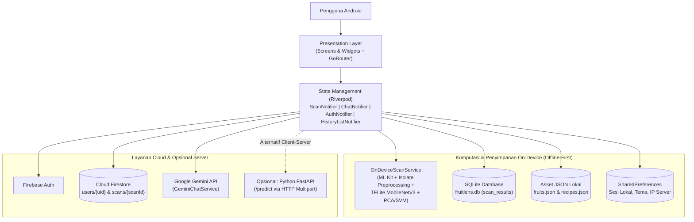
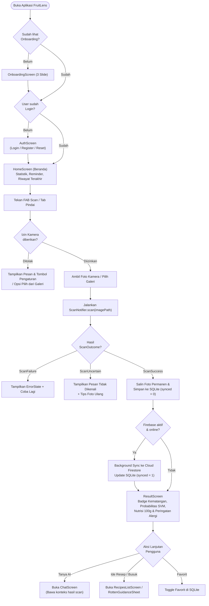
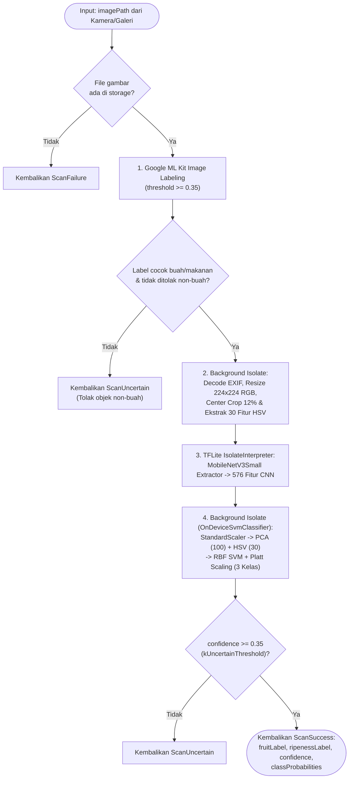
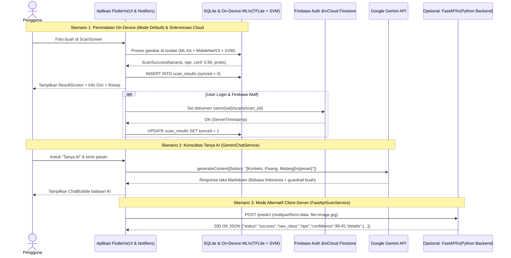
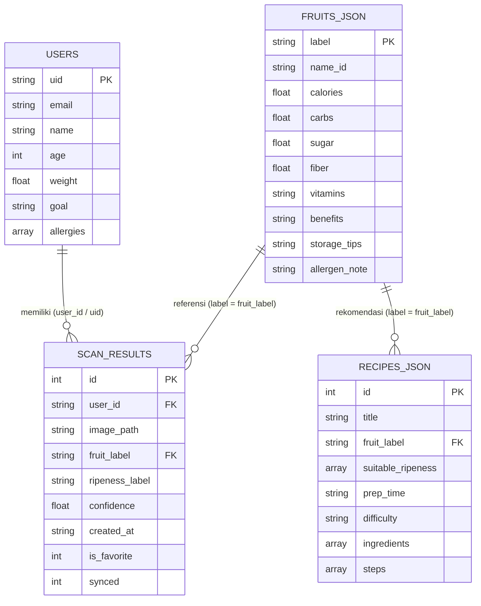

# Bahan Mentah Proposal Proyek Akhir — Pemrograman Mobile 2

> Dokumen ini disusun langsung berdasarkan inspeksi repositori proyek **FruitLens** (`README.md`, `prd.md`, `kebutuhan-sistem.md`, `ARCHITECTURE.md`, `TASKS.md`, `TEAM_ROLES.md`, `INTEGRATION_CONTRACT.md`, `RENCANA_BACKEND_DAN_DATABASE.md`, `pubspec.yaml`, kode sumber di `lib/` dan `backend/`, serta laporan uji di `baca/`).

---

### 1. Judul dan Identitas Proyek

- **Alternatif Nama/Judul Aplikasi:**
  1. **FruitLens: Aplikasi Pemindai Jenis & Kematangan Buah Berbasis On-Device Computer Vision dan Asisten Gizi AI** *(Dipilih — sudah digunakan secara konsisten di `pubspec.yaml`, `README.md`, `prd.md`, dan `android/app/build.gradle.kts` dengan applicationId `com.fruitlens.fruitlens`)*
  2. **RipeScan: Detektor Kematangan Buah dan Konsultan Nutrisi Cerdas** *(Alternatif deskriptif jika ingin menonjolkan deteksi kematangan)*
  3. **BuahKu AI: Asisten Pintar Pemilihan Buah, Nutrisi, dan Resep Olahan** *(Alternatif berbahasa Indonesia penuh)*

- **Identitas Proyek & Anggota Kelompok:**
  - **Mata Kuliah:** Pemrograman Mobile 2 — Politeknik Negeri Indramayu *(juga terintegrasi sebagai proyek gabungan dengan Visi Komputer dan Kecerdasan Buatan menurut `README.md` & `prd.md`)*
  - **Deadline:** `[PERLU DIISI: Tanggal batas pengumpulan proposal dan demo akhir semester]`

| No | Nama Lengkap | NIM | Peran / Jalur Kerja (Sumber: `TASKS.md` & `TEAM_ROLES.md`) |
|---|---|---|---|
| 1 | `[PERLU DIISI: Nama Anggota 1]` | `[PERLU DIISI: NIM Anggota 1]` | Jalur A — Tech Lead, Mobile/Flutter Engineer & Backend/Database |
| 2 | `[PERLU DIISI: Nama Anggota 2]` | `[PERLU DIISI: NIM Anggota 2]` | Jalur A — UI/UX Designer & Frontend Flutter Engineer |
| 3 | `[PERLU DIISI: Nama Anggota 3]` | `[PERLU DIISI: NIM Anggota 3]` | Jalur B — ML / Computer Vision Engineer & AI/LLM Engineer |
| 4 | `[PERLU DIISI: Nama Anggota 4 (jika ada, atau hapus baris ini)]` | `[PERLU DIISI: NIM Anggota 4]` | `[PERLU DIISI: Peran Anggota 4, misal QA & Technical Writer]` |

- **Deskripsi Singkat Aplikasi:**
  FruitLens adalah aplikasi mobile Android berbasis Flutter yang membantu pengguna mengenali buah, mendeteksi tingkat kematangannya (mentah, matang, atau busuk) melalui kamera maupun galeri menggunakan model Visi Komputer (*MobileNetV3Small* + *HSV* + *PCA* + *RBF SVM* via TensorFlow Lite dan Google ML Kit), serta menampilkan informasi nilai gizi dan rekomendasi resep olahan yang sesuai (`README.md`, `lib/services/on_device_scan_service.dart`, `assets/data/`). Aplikasi ini juga dilengkapi asisten percakapan AI berbasis Google Gemini API yang memahami konteks buah hasil pemindaian, peringatan alergi berbasis profil pengguna, serta penyimpanan riwayat pindaian berarsitektur *offline-first* menggunakan SQLite dan sinkronisasi opsional Cloud Firestore (`lib/services/gemini_chat_service.dart`, `lib/data/repositories/history_repository.dart`, `lib/services/firestore_sync_service.dart`).

---

### 2. Latar Belakang dan Permasalahan

- **Masalah Nyata yang Ingin Diselesaikan:**
  Banyak konsumen kesulitan menilai apakah buah yang akan dibeli atau dikonsumsi sudah matang sempurna, masih mentah, atau mulai membusuk hanya dari pengamatan sekilas, serta tidak mengetahui rincian kandungan gizi dan cara pengolahan yang tepat (`prd.md` bagian 1–2).
  - **Contoh Situasi Konkret:**
    1. *Saat berbelanja di pasar atau supermarket (minim sinyal):* Pembeli ingin memilih pisang atau buah segar yang pas untuk dikonsumsi hari ini atau disimpan beberapa hari ke depan, namun ragu membedakan kondisi matang optimal vs mulai membusuk, dan tidak memiliki akses cepat untuk mengetahui kandungan kalori/gula buah tersebut (`prd.md` US-02, US-06).
    2. *Di dapur rumah:* Pengguna memiliki buah yang hampir lewat matang dan bingung mengolahnya menjadi makanan sehat (misalnya *smoothie* atau *pancake*), atau memiliki riwayat alergi tertentu sehingga perlu berhati-hati sebelum mengonsumsi buah maupun resep olahannya (`README.md`, `prd.md` US-08, US-09).

- **Kondisi Saat Ini / Solusi yang Sudah Ada dan Kekurangannya:**
  Saat ini informasi mengenai ciri kematangan buah, tabel kandungan nutrisi per 100 gram, peringatan alergen, dan ide resep olahan tersebar di berbagai tempat terpisah (artikel web, mesin pencari, aplikasi resep umum, atau aplikasi penghitung kalori manual) dan tidak terhubung secara kontekstual dengan buah fisik yang sedang dipegang pengguna (`prd.md` bagian 1–2). Aplikasi pencatat nutrisi umum menuntut input teks manual, sedangkan pengecekan berbasis pencarian web tidak bekerja saat pengguna berada di lokasi dengan koneksi internet terbatas. `[PERLU DIVERIFIKASI: Bandingkan secara spesifik dengan 2–3 aplikasi sejenis yang ada di Play Store jika dosen meminta tinjauan pustaka/aplikasi pembanding]`.

- **Alasan Aplikasi Ini Perlu Dikembangkan:**
  Kemajuan teknologi *on-device machine learning* memungkinkan proses ekstraksi fitur citra dan klasifikasi kematangan dijalankan langsung di perangkat mobile (latensi target `<= 2 detik`, `kebutuhan-sistem.md` NFR-01) tanpa bergantung penuh pada koneksi internet. Menggabungkan *Computer Vision*, informasi gizi lokal (`assets/data/fruits.json`), kurasi resep sesuai tingkat kematangan (`assets/data/recipes.json`), profil alergi pengguna (`UserProfile`), dan chatbot AI kontekstual dalam satu aplikasi menjawab kebutuhan pengguna secara ringkas dalam satu alur (`prd.md` bagian 2).

- **Target Pengguna (`prd.md` bagian 4):**

| Segmen Pengguna | Konteks Pemakaian | Kebutuhan Utama |
|---|---|---|
| **Ibu rumah tangga / pembeli di pasar** | Memilih buah saat berbelanja (sering kali offline/sinyal lemah) dan mencari ide olahan di rumah | Deteksi kematangan cepat tanpa internet, rekomendasi resep olahan agar buah tidak terbuang |
| **Pelaku diet / pola hidup sehat** | Mengatur asupan harian dan memantau kecocokan buah dengan target kesehatan/alergi | Info cepat kalori, karbohidrat, gula, serat per 100 g, dan peringatan alergi personal |
| **Mahasiswa / pengguna umum** | Ingin tahu cara menyimpan buah agar awet dan belajar kandungan gizi buah | Tips penyimpanan, fakta gizi, dan tanya jawab cepat dengan asisten AI |
| **Dosen / penguji akademik** | Evaluasi tugas besar Pemrograman Mobile 2, Visi Komputer, dan AI | Bukti integrasi nyata Flutter Clean Architecture, ML on-device/API, database lokal-cloud, dan LLM |

- **Data Pendukung:**
  - *Data internal proyek (terverifikasi di repositori):* `assets/data/fruits.json` memuat data nutrisi untuk **10 jenis buah** (`apple`, `banana`, `orange`, `mango`, `avocado`, `tomato`, `strawberry`, `grape`, `watermelon`, `pineapple`), `assets/data/recipes.json` memuat **7 resep** olahan buah, dan model aktif SVM pada `assets/models/svm_pisang_meta.json` memiliki **6.162 support vectors** untuk **3 kelas kematangan pisang** (`ripe`, `rotten`, `unripe`).
  - `[PERLU DIISI / PERLU DIVERIFIKASI: Data statistik eksternal resmi mengenai tingkat pemborosan pangan (food waste) buah rumah tangga atau tren konsumsi buah/aplikasi kesehatan di Indonesia (misal dari BPS, FAO, atau Kemenkes RI) untuk memperkuat urgensi latar belakang]`

---

### 3. Tujuan dan Fitur Aplikasi

- **Tujuan Pengembangan (`prd.md` bagian 3):**
  - **Tujuan Umum:** Membangun aplikasi mobile Android cerdas bernama **FruitLens** yang mengintegrasikan Flutter, Visi Komputer, dan Kecerdasan Buatan untuk membantu pengguna mengidentifikasi buah, menilai kematangan, memperoleh informasi gizi dan resep kontekstual, serta menyimpan riwayat pemindaian secara *offline-first*.
  - **Tujuan Khusus (Terukur):**
    1. Menghasilkan aplikasi mobile Flutter berarsitektur modular (*Clean Architecture* ringan + Riverpod) dengan alur scan utama selesai dalam `<= 3` ketukan dari beranda dan berjalan stabil tanpa *crash* pada skenario penolakan izin kamera maupun kondisi offline (`kebutuhan-sistem.md` NFR-05, NFR-06).
    2. Mengimplementasikan pipeline *Computer Vision* untuk mengklasifikasikan kematangan buah (target akurasi jenis buah `>= 90%`, kematangan `>= 80%` pada data uji, waktu inferensi `<= 2 detik` di perangkat Android `minSdk 26`, ukuran APK `<= 100 MB` — `kebutuhan-sistem.md` NFR-01 s.d. NFR-04, `prd.md` bagian 3).
    3. Menyediakan sistem informasi gizi per 100 gram, rekomendasi resep sesuai tingkat kematangan, filter peringatan alergi profil, serta asisten chatbot AI berbahasa Indonesia yang terhubung langsung dengan konteks hasil pemindaian (`kebutuhan-sistem.md` FR-14 s.d. FR-20).
    4. Menerapkan persistensi data *offline-first* berbasis SQLite (`sqflite`) untuk riwayat pemindaian lengkap dengan fitur favorit, pencarian/filter, serta dukungan autentikasi pengguna dan sinkronisasi awan opsional via Firebase (`kebutuhan-sistem.md` FR-22 s.d. FR-28).

- **Tabel Fitur Utama (Maksimal 8 Fitur Utama):**

| No | Fitur | Fungsi | Prioritas (Wajib/Pelengkap) | Cakupan |
|---|---|---|---|---|
| 1 | **Autentikasi & Profil Alergi** | Registrasi, login, reset password, kelola sesi, serta simpan usia, berat, tujuan sehat, dan daftar alergi (`lib/services/auth_service.dart`, `firebase_auth_service.dart`, `user_profile.dart`) | **Wajib** (Auth) / **Pelengkap** (Profil Alergi) | **MVP** (Auth dasar) & **Opsional/Lanjutan** (Preferensi alergi & cloud sync) |
| 2 | **Pindai Buah (Kamera & Galeri)** | Mengambil foto langsung dengan pratinjau kamera/panduan framing atau memilih foto dari galeri, menangani izin kamera secara aman (`lib/ui/screens/scan_screen.dart`, `camera_access.dart`) | **Wajib** | **MVP** |
| 3 | **Deteksi Objek & Klasifikasi Kematangan AI (Offline)** | Memvalidasi objek buah via Google ML Kit lalu memprediksi kelas kematangan + probabilitas kelas SVM on-device di Isolate (`lib/services/on_device_scan_service.dart`, `scan_notifier.dart`) | **Wajib** | **MVP** |
| 4 | **Halaman Hasil, Nutrisi & Peringatan Alergi** | Menampilkan foto, jenis buah, badge kematangan + probabilitas SVM, gizi per 100 g (`fruits.json`), tips simpan, serta banner peringatan bila cocok/bertentangan dengan alergi profil (`result_screen.dart`, `result_success_view.dart`) | **Wajib** (Nutrisi) / **Pelengkap** (Peringatan Alergi) | **MVP** (Hasil & Nutrisi) |
| 5 | **Asisten Chatbot Buah AI Kontekstual** | Tanya jawab interaktif berbahasa Indonesia via Gemini API dengan konteks hasil pindai terakhir & chip saran pertanyaan, dilengkapi fallback offline (`chat_screen.dart`, `gemini_chat_service.dart`) | **Wajib** | **MVP** |
| 6 | **Riwayat Pindai Offline & Favorit** | Menyimpan otomatis setiap hasil scan ke SQLite (`fruitlens.db`), melihat detail, filter/cari, tandai favorit, dan hapus dengan konfirmasi (`history_screen.dart`, `history_repository.dart`) | **Wajib** (CRUD Riwayat) / **Pelengkap** (Favorit & Filter) | **MVP** (CRUD Lokal) |
| 7 | **Rekomendasi Ide Resep Cerdas** | Menampilkan resep olahan buah dari `recipes.json` yang difilter berdasarkan jenis buah & tingkat kematangan (plus panduan kompos/daur ulang bila buah busuk via `rotten_guidance_sheet.dart`) | **Pelengkap** | **Opsional / Pengembangan Lanjutan** *(sudah terimplementasi)* |
| 8 | **Sinkronisasi Cloud & Tema Gelap (Night Harvest)** | Sinkronisasi riwayat & profil ke Cloud Firestore saat online (`firestore_sync_service.dart`), konfigurasi tema terang/gelap (`theme_controller.dart`), serta pengingat kesegaran buah matang di Beranda (`home_smart_reminder_card.dart`) | **Pelengkap** | **Opsional / Pengembangan Lanjutan** *(sudah terimplementasi)* |

- **Alur Penggunaan Aplikasi (Sudut Pandang Pengguna, Sumber: `lib/core/router/app_router.dart` & `ui/screens/`):**
  1. **Pembukaan & Pengenalan:** Pengguna membuka aplikasi ➔ melihat `SplashScreen` singkat (`/splash`). Jika baru pertama kali membuka aplikasi (`kOnboardingSeenKey == false`), pengguna diarahkan ke `OnboardingScreen` (`/onboarding`) berisi 3 slide pengantar.
  2. **Autentikasi (Gated Flow):** Jika belum login, `GoRouter` mengarahkan pengguna ke `AuthScreen` (`/auth`) untuk masuk atau mendaftar akun baru (tersedia juga `ForgotPasswordScreen` di `/forgot-password`).
  3. **Beranda (`HomeScreen` `/`):** Pengguna masuk ke shell navigasi utama 5 tab (*Beranda, Riwayat, Pindai FAB Tengah, Resep/Chatbot sesuai konfigurasi nav, Profil* — diverifikasi di `main_scaffold_with_nav.dart`). Di Beranda pengguna melihat kartu hero pindai, statistik cepat, *Smart Freshness Reminder*, riwayat scan terakhir, resep pilihan, dan tips harian.
  4. **Pemindaian Buah (`ScanScreen`):** Pengguna menekan tombol **Pindai** (FAB tengah) ➔ memberikan izin kamera ➔ membidik buah atau memilih foto dari galeri ➔ sistem memvalidasi dan mengklasifikasikan gambar di background Isolate.
  5. **Analisis Hasil (`ResultScreen`):**
     - Jika objek bukan buah atau tingkat keyakinan di bawah `kUncertainThreshold` (`0.35`), muncul tampilan `ScanUncertain` (*"Buah tidak dikenali"*) dengan saran foto ulang.
     - Jika berhasil (`ScanSuccess`), pengguna melihat nama buah, tingkat kematangan (`Mentah`, `Matang`, `Busuk`), rincian grafik probabilitas kelas SVM, informasi nutrisi per 100 g, tips penyimpanan, serta peringatan alergi jika profil cocok. Hasil otomatis tersimpan ke SQLite dan dipicu sinkronisasi ke Firestore jika Firebase aktif.
  6. **Tindak Lanjut Pengguna (Konversi Tujuan):**
     - Menekan **"Tanya AI"** ➔ membuka `ChatScreen` dengan banner konteks buah hasil pindai aktif untuk berkonsultasi nutrisi/olahan.
     - Menekan **"Ide Resep"** (atau **"Tips Daur Ulang"** jika statusnya busuk) ➔ membuka rekomendasi resep di `RecipesListScreen`/`RecipeDetailScreen` atau panduan kompos (`RottenGuidanceSheet`).
     - Mengakses tab **Riwayat** untuk meninjau ulang hasil pindaian sebelumnya secara offline atau tab **Profil** untuk mengubah tema (*Fresh Harvest* / *Night Harvest*), alergi, dan pengaturan akun.

---

### 4. Rancangan Teknologi

#### 4.1 Mobile Client
- **Teknologi yang Dipilih:** **Flutter `3.41.9`** & **Dart `3.11.5`** (di `pubspec.yaml`: `sdk: ^3.11.5`, target Android `minSdk = 26` / Android 8.0 Oreo pada `android/app/build.gradle.kts`).
- **Package Utama (`pubspec.yaml`):**
  - State & Routing: `flutter_riverpod: ^3.3.2`, `go_router: ^17.5.0`
  - Kamera & Gambar: `camera: ^0.12.0+2`, `image_picker: ^1.2.4`, `permission_handler: 12.0.1`, `image: ^4.12.0`
  - AI & Visi Komputer: `tflite_flutter: ^0.12.1`, `google_mlkit_image_labeling: ^0.15.0`, `google_generative_ai: ^0.4.7`
  - Penyimpanan Lokal & Konfigurasi: `sqflite: ^2.4.2+1`, `shared_preferences: ^2.5.6`, `path_provider: ^2.1.5`, `flutter_dotenv: ^6.0.1`
  - Cloud & Jaringan: `firebase_core: ^3.12.0`, `firebase_auth: ^5.5.0`, `cloud_firestore: ^5.6.5`, `dio: ^5.8.0+1`, `http: ^1.6.0`
  - UI & Markdown: `google_fonts: ^6.2.1`, `flutter_markdown: ^0.7.6`
- **Alasan Pemilihan:** Menjadi syarat wajib mata kuliah (*stack* Flutter + Dart), memiliki ekosistem plugin resmi untuk TFLite, ML Kit, kamera, SQLite, dan Firebase, serta mampu menjalankan komputasi berat secara paralel di Dart `Isolate` tanpa memblokir *rendering thread* 60 fps (`lib/services/on_device_scan_service.dart`).
- **Alternatif yang Ditolak:** Kotlin Native / Jetpack Compose (hanya Android dan tidak sesuai ketentuan mata kuliah Flutter) serta React Native (bridge JS kurang efisien untuk memproses array piksel `Float32List` gambar secara langsung dibanding Dart TypedData + FFI `tflite_flutter`).

#### 4.2 Backend, Database, dan Hosting
- **Teknologi yang Dipilih:** Arsitektur **Hybrid Offline-First & BaaS + Opsional REST API Microservice** (`RENCANA_BACKEND_DAN_DATABASE.md`, `lib/services/`):
  - **Database Lokal (Utama/Offline-First):** **SQLite** via `sqflite` (`fruitlens.db`) untuk menyimpan riwayat scan + `SharedPreferences` untuk sesi lokal (`LocalAuthService`), preferensi tema, status onboarding, dan alamat server; serta JSON statis lokal (`assets/data/fruits.json`, `recipes.json`).
  - **Backend-as-a-Service (Cloud Auth & Sync):** **Firebase Authentication** (`FirebaseAuthService`) dan **Cloud Firestore** (`FirestoreSyncService`), sudah terkonfigurasi dengan `android/app/google-services.json`.
  - **REST API Opsional AI Backend (`backend/`):** **Python 3.11 + FastAPI + Uvicorn + TensorFlow + Scikit-Learn + OpenCV** (`backend/main.py`, `backend/Dockerfile`, `backend/requirements.txt`) yang diekspos sebagai REST API HTTP JSON (`GET /`, `POST /predict`).
- **Alasan Pemilihan:**
  1. SQLite menjamin aplikasi tetap berjalan di pasar/lokasi tanpa internet (`NFR-08`, `FR-28`).
  2. Firebase Auth & Firestore mempercepat implementasi autentikasi JWT dan sinkronisasi multi-perangkat tanpa membangun server autentikasi dari nol.
  3. FastAPI (Python) dipilih pada sub-sistem `backend/` karena model awal di Google Colab berformat `.pkl` (Scikit-Learn + TensorFlow), sehingga API REST paling natural dan mudah diuji via Swagger `/docs`.
- **Alternatif yang Ditolak:** Express.js / Laravel (tidak memiliki dukungan native untuk menjalankan model `.pkl` Scikit-Learn dan `.tflite`/TensorFlow Python), serta GraphQL/WebSocket (tidak diperlukan karena komunikasi hanya berupa request-response unggah gambar atau chat per giliran).
- **Keputusan Hosting Backend FastAPI:** `[BELUM DIPUTUSKAN]` *(Catatan: Untuk mode default aplikasi saat ini di `lib/providers/service_providers.dart`, inferensi CV sudah berjalan 100% on-device sehingga tidak membutuhkan hosting server AI, sementara Firebase menggunakan infrastruktur cloud Google)*. Bila jalur backend FastAPI tetap didemokan/dipakai:
  - **Opsi 1:** Hosting lokal via LAN / Hotspot laptop (`uvicorn main:app --host 0.0.0.0 --port 8000` dengan `ServerConfigNotifier` di aplikasi).
  - **Opsi 2:** Hosting Container Docker di PaaS gratis (Hugging Face Spaces / Render / Railway menggunakan `backend/Dockerfile` yang sudah tersedia).
  - **Rekomendasi:** Gunakan **On-Device Inference sebagai mode utama** di APK final agar bebas ketergantungan server, dan siapkan **Opsi 1 (Local LAN FastAPI)** atau **Opsi 2 (Hugging Face Spaces)** hanya sebagai demonstrasi pembanding microservice bila diminta penguji. Alasannya, mode on-device paling andal saat presentasi tanpa risiko server cloud *cold-start* atau putus Wi-Fi.

#### 4.3 AI / Computer Vision dan LLM
Sistem menggunakan **2 modul AI yang terhubung langsung ke alur pengguna**:

1. **Modul Computer Vision — Klasifikasi Objek & Kematangan Buah:**
   - **Metode/Model:** Hybrid 4-tahap (`lib/services/on_device_scan_service.dart`, `ml_kit_fruit_detector.dart`, `on_device_image_preprocessor.dart`, `on_device_svm_classifier.dart`):
     1. *Pre-validator:* **Google ML Kit Image Labeling** (`confidenceThreshold: 0.35`) menyaring foto non-buah/non-makanan (misal wajah, laptop, elektronik).
     2. *Deep Feature Extractor:* **TensorFlow Lite `MobileNetV3Small`** (`assets/models/mobilenet_v3_extractor.tflite`), menghasilkan vektor **576 fitur**.
     3. *Color Descriptor:* **Masked HSV Histogram + Moments** (center crop 12%, masking spektrum warna buah Hue `0–85`, Saturation `>= 28`, Value `>= 20`), menghasilkan **30 fitur** warna.
     4. *Classifier:* **StandardScaler + PCA (100 komponen) + RBF SVM + Platt Probability Calibration** (`assets/models/svm_pisang_meta.json` & `svm_pisang_weights.bin`, total `6.162` support vectors).
   - **Input & Output:** Input berupa file gambar kamera/galeri yang di-decode dan di-resize ke `224x224x3` RGB `Float32List` `[0.0–255.0]`. Output berupa `ScanOutcome` (`ScanSuccess` berisi `fruitLabel`, `ripenessLabel` untuk 3 kelas `unripe`/`ripe`/`rotten`, `fruitConfidence`, `ripenessConfidence`, dan `classProbabilities`; atau `ScanUncertain` / `ScanFailure`).
   - **Lokasi Eksekusi:** **On-Device** sepenuhnya di background `Isolate` & `IsolateInterpreter` (`tflite_flutter`). *(Jalur alternatif client-server `FastApiScanService` ke Python `backend/main.py` juga tersedia di repo).*
   - **Fungsi di Aplikasi:** Menentukan status kematangan buah saat pindai, menyaring foto bukan buah agar tidak salah masuk riwayat, memicu informasi nutrisi, memfilter resep yang relevan (atau panduan kompos jika busuk), serta menjadi konteks otomatis bagi chatbot AI.
   - **Batasan & Risiko (Berdasarkan `baca/laporan_audit_ondevice_v2.md` & `baca/laporan_evaluasi_model.md`):**
     - Model SVM aktif saat ini baru dilatih secara spesifik untuk komoditas **Pisang 3 kelas** (`ripe`, `rotten`, `unripe`); buah lain belum memiliki bobot SVM tersendiri.
     - Pada pipeline `svm_pisang_3kelasNew.pkl`, `StandardScaler()` menormalisasi ulang bobot `hsv_weight = 2.5` sehingga jarak kernel RBF masih didominasi **94.1% fitur CNN vs 5.9% HSV**, membuat model sensitif terhadap rasio latar belakang putih atau tekstur kayu pada pisang mentah/hijau.
     - Perbedaan minor interpolasi resize (`package:image` vs `PIL.Image`) menimbulkan selisih tensor kecil (`hsv_max_diff` sekitar `0.013–0.069`), meskipun paritas rumus SVM Dart vs Python sudah identik (`selisih <= 3.86e-8`).

2. **Modul LLM — Asisten Konseling Buah & Resep (`GeminiChatService`):**
   - **Metode/API:** **Google Gemini API** melalui SDK `google_generative_ai: ^0.4.7` (`lib/services/gemini_chat_service.dart`), dengan *system instruction* dan *guardrail* ketat berbahasa Indonesia (membatasi jawaban hanya pada buah, kematangan, nutrisi, penyimpanan, keamanan pangan/alergi, dan resep). Jika `.env` tidak memiliki `GEMINI_API_KEY`, otomatis memakai `FakeChatService` sebagai fallback.
   - **Input & Output:** Input berupa riwayat percakapan (`List<ChatTurn>`), pesan teks pengguna, dan opsional `scanContext` (misal jenis buah & kematangan hasil scan terakhir). Output berupa teks jawaban terstruktur berformat Markdown (`flutter_markdown`).
   - **Lokasi Eksekusi:** Server cloud Google Gemini via HTTPS.
   - **Batasan & Risiko:** Membutuhkan koneksi internet aktif, bergantung pada batas kuota (*rate limit*) dan potensi biaya API key Google AI Studio, serta potensi latensi jaringan. Default model yang dipakai adalah `'gemini-3.5-flash-lite'` (`lib/providers/service_providers.dart:35`, `lib/services/gemini_chat_service.dart:9`, dapat di-override via `GEMINI_MODEL` di `.env`) yang sudah diverifikasi aktif di endpoint resmi `generativelanguage.googleapis.com`.

#### 4.4 Architecture (Clean Architecture Ringan — Sumber: `ARCHITECTURE.md` & Struktur `lib/`)
- **Pemetaan Layer:**
  1. **Presentation Layer (`lib/ui/` & `lib/core/router/`, `lib/core/theme/`):** Berisi `screens/` (15 layar) dan `widgets/` reusable, `GoRouter` (`StatefulShellRoute`), dan tema Material 3 (*Fresh Harvest* & *Night Harvest*). Dilarang mengakses database, HTTP, atau TFLite secara langsung; hanya membaca state lewat `ref.watch` dan memicu aksi via `ref.read`.
  2. **Application / Domain Contract Layer (`lib/providers/` & kontrak abstrak di `lib/services/`, `lib/data/repositories/`):** Berisi `Notifier`/`AsyncNotifier` (`ScanNotifier`, `ChatNotifier`, `AuthNotifier`, `HistoryListNotifier`, `ServerConfigNotifier`) yang mengatur logika bisnis, thresholding, state `AsyncValue` (`loading`, `error`, `data`), serta interface abstrak (`ScanService`, `ChatService`, `AuthService`, `CloudSyncService`, `HistoryRepository`, `FruitInfoRepository`, `RecipeRepository`) agar mudah di-mock saat testing.
  3. **Data & Infrastructure Layer (`lib/data/models/`, `lib/data/repositories/` implementasi, `lib/services/` implementasi):** Berisi entity/model immutable (`ScanOutcome` sealed class, `ScanResult`, `FruitInfo`, `Recipe`, `UserProfile`, `ChatTurn`), SQLite repository (`SqfliteHistoryRepository`), asset loaders (`AssetFruitInfoRepository`, `AssetRecipeRepository`), layanan AI (`OnDeviceScanService`, `FastApiScanService`, `GeminiChatService`), serta Firebase (`FirebaseAuthService`, `FirestoreSyncService`).

- **Contoh Struktur Folder Aktual (`lib/` & `backend/`):**
```text
fruitlens/
├── assets/
│   ├── data/                  # fruits.json, recipes.json
│   ├── images/                # brand, auth, onboarding, fruits
│   └── models/                # mobilenet_v3_extractor.tflite, svm_pisang_meta.json, svm_pisang_weights.bin, labels_*.txt
├── backend/                   # Opsional FastAPI microservice (main.py, Dockerfile, requirements.txt, test_api.py)
├── lib/
│   ├── main.dart              # Bootstrap dotenv, opsional Firebase.initializeApp(), ProviderScope
│   ├── app.dart               # MaterialApp.router + ThemeMode
│   ├── core/
│   │   ├── constants/         # app_constants.dart (threshold 0.6 & 0.35), app_strings.dart
│   │   ├── router/            # app_router.dart (GoRouter + redirect auth/onboarding)
│   │   ├── theme/             # app_colors.dart, harvest_colors.dart, app_theme.dart, theme_controller.dart
│   │   └── utils/             # fruit_name_helper.dart
│   ├── data/
│   │   ├── models/            # scan_outcome.dart, scan_result.dart, fruit_info.dart, recipe.dart, user_profile.dart, chat_turn.dart
│   │   └── repositories/      # history_repository.dart, fruit_info_repository.dart, recipe_repository.dart
│   ├── providers/             # auth_providers.dart, scan_notifier.dart, chat_notifier.dart, history_providers.dart, service_providers.dart
│   ├── services/              # on_device_scan_service.dart, ml_kit_fruit_detector.dart, on_device_svm_classifier.dart,
│   │                          # fastapi_scan_service.dart, gemini_chat_service.dart, auth_service.dart, firebase_auth_service.dart, firestore_sync_service.dart
│   └── ui/
│       ├── screens/           # home, scan, result, chat, history, history_detail, recipes_list, recipe_detail, profile, auth, onboarding, splash
│       └── widgets/           # widget modular reusable & grafik SVM
└── test/                      # 87 unit & widget tests (cermin struktur lib/)
```

#### 4.5 State Management
- **Teknologi yang Dipilih:** **Riverpod (`flutter_riverpod: ^3.3.2`)** menggunakan API modern `Notifier` dan `AsyncNotifier` (`ARCHITECTURE.md` bagian 2).
- **Alasan Pemilihan:**
  1. Mendukung dependency injection yang bersih dan compile-safe lewat `Provider` sehingga seluruh implementasi *service* dan *repository* (`ScanService`, `AuthService`, `HistoryRepository`) mudah di-swap antara lokal/fake/cloud maupun di-override pada `ProviderScope` saat pengujian otomatis (terbukti pada 87 automated tests yang lulus).
  2. `AsyncValue` memaksa UI menangani seluruh state (`loading`, `error`, `data`) secara eksplisit dan konsisten di setiap layar.
  3. Tidak bergantung pada `BuildContext` untuk mengakses dependency antar-provider (misalnya `ScanNotifier` membaca `historyListProvider` dan `cloudSyncServiceProvider` langsung via `ref`).
- **Alternatif yang Ditolak:** **BLoC/Cubit** (membutuhkan lebih banyak boilerplate event/state dan `BlocProvider` berbasis widget tree untuk dependency injection antar-service) serta **GetX** (menjauhkan kode dari konvensi resmi Flutter dan mempermudah munculnya global mutable state yang melanggar aturan Clean Architecture di `ARCHITECTURE.md`).

---

### 5. Rancangan Arsitektur dan Alur Sistem

#### 5.1 Gambaran Arsitektur Keseluruhan
FruitLens mengadopsi arsitektur **On-Device First dengan Integrasi Cloud Hybrid**: pemrosesan citra CV (`ML Kit` + `TFLite` + `SVM`), penyimpanan riwayat (`SQLite`), dan basis data gizi/resep (`JSON asset`) berjalan 100% secara lokal di perangkat agar instan dan bebas sinyal. Sementara itu, layanan jaringan bersifat komplementer untuk autentikasi akun (`Firebase Auth`), sinkronisasi cadangan lintas perangkat (`Cloud Firestore`), tanya-jawab LLM (`Google Gemini API`), serta microservice python opsional (`FastAPI`).



#### 5.2 Flowchart Alur Sistem Utama

**Flow A — Alur Fitur Inti (Scan hingga Riwayat & Tindak Lanjut):**



**Flow B — Alur Fitur AI / Computer Vision On-Device (`lib/services/on_device_scan_service.dart`):**



#### 5.3 Alur Komunikasi Aplikasi <-> Backend <-> Layanan AI



- **Ringkasan Format Request/Response API (`backend/main.py` & `INTEGRATION_CONTRACT.md`):**
  - Request `POST /predict`: `Content-Type: multipart/form-data` dengan field `file` (JPG/PNG).
  - Response `200 OK`:
    ```json
    {
      "status": "success",
      "fruit": "Pisang",
      "fruit_label": "banana",
      "prediction": "Matang",
      "raw_class": "ripe",
      "confidence": 98.45,
      "details": { "unripe": 0.32, "ripe": 98.45, "rotten": 1.23 }
    }
    ```

#### 5.4 Rancangan Database
Terdapat tiga sumber data terstruktur di aplikasi (`lib/data/repositories/history_repository.dart`, `lib/services/firestore_sync_service.dart`, `assets/data/fruits.json`, `assets/data/recipes.json`):
1. **SQLite Lokal (`fruitlens.db`, schema version 2) — Tabel `scan_results`:**
   - Kolom: `id` (`INTEGER PK AUTOINCREMENT`), `user_id` (`TEXT DEFAULT 'guest'`), `image_path` (`TEXT`), `fruit_label` (`TEXT`), `ripeness_label` (`TEXT`), `confidence` (`REAL`), `created_at` (`TEXT` ISO 8601), `is_favorite` (`INTEGER 0/1`), `synced` (`INTEGER 0/1`).
2. **Cloud Firestore (NoSQL):**
   - Koleksi `users/{uid}`: `uid`, `email`, `name`, `age`, `weight`, `goal`, `allergies` (`array<string>`), `updated_at`.
   - Sub-koleksi `users/{uid}/scans/{scanId}`: `image_path`, `fruit_label`, `ripeness_label`, `confidence`, `created_at`, `is_favorite`, `synced_at`.
3. **Asset JSON Lokal (Read-only Curated Content):**
   - `fruits.json` (`label` PK, `name_id`, `calories`, `carbs`, `sugar`, `fiber`, `vitamins`, `benefits`, `storage_tips`, `allergen_note`).
   - `recipes.json` (`id` PK, `title`, `fruit_label` FK, `suitable_ripeness`, `prep_time`, `difficulty`, `ingredients`, `steps`).



#### 5.5 Daftar Endpoint Utama
Karena arsitektur menggunakan kombinasi **Python FastAPI (opsional server AI)** dan **SDK Cloud (Firebase + Gemini)**:

| No | Layanan / Endpoint | Method | Path / Operasi | Fungsi |
|---|---|---|---|---|
| 1 | FastAPI AI Backend (`backend/main.py`) | `GET` | `/` | *Health check* status server, nama file model SVM aktif, bobot HSV, dan daftar kelas |
| 2 | FastAPI AI Backend (`backend/main.py`) | `POST` | `/predict` | Menerima upload foto buah (`multipart/form-data`), mengembalikan prediksi kematangan & rincian probabilitas |
| 3 | FastAPI Swagger Docs | `GET` | `/docs` | Dokumentasi interaktif OpenAPI untuk pengujian endpoint backend secara langsung |
| 4 | Google Gemini API (`google_generative_ai`) | `POST` *(SDK)* | `generateContent` | Mengirim prompt pengguna + riwayat chat + `scanContext` dengan *system instruction* nutrisi buah |
| 5 | Firebase Authentication (`firebase_auth`) | `SDK` | `signInWithEmailAndPassword`, `createUserWithEmailAndPassword`, `sendPasswordResetEmail`, `signOut` | Manajemen akun, registrasi, login, reset password, dan sesi persisten |
| 6 | Cloud Firestore (`cloud_firestore`) | `SDK` | `users/{uid}` & `users/{uid}/scans/{scanId}` | Sinkronisasi profil alergi pengguna dan backup riwayat pindaian ke awan |

---

### 6. Rencana Implementasi

#### 6.1 Tahapan Pengembangan (Disusun berdasarkan `TASKS.md` Fase 1–7 & `prd.md` Bagian 12 untuk durasi 1 semester / ~14 minggu)

| Fase / Minggu | Aktivitas | Output / Deliverable | Status di Repo (`TASKS.md`) |
|---|---|---|---|
| **Fase 1** *(Minggu 1–2)* | Setup proyek Flutter, konvensi lint, `ProviderScope`, routing `GoRouter` 5 tab + FAB, tema Material 3 (*Fresh & Night Harvest*) | Kerangka proyek, navigasi shell, dan sistem desain token terpusat | `DONE` (T-01 s.d. T-04) |
| **Fase 2** *(Minggu 3–4)* | Penyusunan `INTEGRATION_CONTRACT.md`, antarmuka abstrak (`ScanService`, `ChatService`), fake services untuk pengembangan paralel, dan dataset nutrisi `fruits.json` | Kontrak antar-modul dan *repository* nutrisi teruji | `DONE` (T-10 s.d. T-13) |
| **Fase 3** *(Minggu 5–6)* | Implementasi layar kamera/galeri + penanganan izin, `ScanNotifier`, dan `ResultScreen` (tampilan hasil, loading, uncertain, nutrisi) | Alur inti pindai buah berfungsi end-to-end | `DONE` (T-20 s.d. T-22) |
| **Fase 4** *(Minggu 7–8)* | Implementasi database lokal SQLite (`HistoryRepository` CRUD + favorit), layar Riwayat & Detail, modul Autentikasi (`LocalAuth` & `FirebaseAuth`), dan Profil Alergi | Persistensi riwayat offline, manajemen akun, dan filter alergi | `DONE` (T-30 s.d. T-34) |
| **Fase 5** *(Minggu 9–10)* | Pembangunan UI Chatbot AI, integrasi `GeminiChatService`, kurasi `recipes.json`, layar Resep, serta panduan kompos buah busuk | Modul chatbot kontekstual dan rekomendasi resep berdasarkan kematangan | `DONE` (T-40 s.d. T-41, BE-05) |
| **Fase 6** *(Minggu 11–12)* | Training model CV (`MobileNetV3` + `Masked HSV` + `SVM`), konversi ke `.tflite` & `.bin`/`.json`, integrasi `OnDeviceScanService` dengan Isolate + ML Kit, serta Cloud Firestore Sync | Pipeline inferensi AI 100% on-device + sinkronisasi awan + opsional server FastAPI | `DONE` (B-01 s.d. B-04, BE-02 s.d. BE-04, audit on-device) |
| **Fase 7** *(Minggu 13–14)* | Pengujian skenario gagal (izin ditolak, offline, gambar non-buah), perbaikan bug threshold & model Gemini, audit keamanan `.env`, build APK rilis, serta penyusunan laporan & slide demo | Suite automated tests lulus (`87/87` test), `flutter analyze` bersih, APK rilis (`<= 100 MB`), laporan akhir & demo | `IN PROGRESS` *(Tinggal finalisasi perbaikan model Gemini, re-training SVM opsional, dan demo)* |

#### 6.2 Pembagian Tugas per Anggota (Berdasarkan `TEAM_ROLES.md` & `TASKS.md`)

| Anggota | Tanggung Jawab | Modul yang Dikerjakan |
|---|---|---|
| **Anggota 1** `[PERLU DIISI: Nama]` | **Tech Lead, Mobile Engineer & Backend Integration:** Arsitektur Clean Architecture, state management Riverpod, kamera/izin, integrasi on-device TFLite/Isolate, SQLite, Firebase Auth/Firestore Sync, serta FastAPI bridge | `lib/providers/`, `lib/data/`, `lib/services/` (`on_device_*`, `firebase_*`, `firestore_*`), `backend/` |
| **Anggota 2** `[PERLU DIISI: Nama]` | **UI/UX Designer & Frontend Flutter Engineer:** Desain sistem *Fresh/Night Harvest*, komponen UI modular bebas *AI slop*, aksesibilitas, navigasi `GoRouter`, dan seluruh layar aplikasi + aset resep/tips | `lib/core/theme/`, `lib/core/router/`, `lib/ui/screens/`, `lib/ui/widgets/`, `assets/data/recipes.json` |
| **Anggota 3** `[PERLU DIISI: Nama]` | **ML / Computer Vision & AI/LLM Engineer (Jalur B):** Pengumpulan dataset, training model hybrid `MobileNetV3Small` + `HSV` + `SVM` di Google Colab, ekspor bobot & `.tflite`, evaluasi confusion matrix, serta perancangan prompt/guardrail Gemini API | `ml/` / Google Colab, `assets/models/`, `baca/*.md`, `lib/services/gemini_chat_service.dart` |
| **Anggota 4 (Opsional)** `[PERLU DIISI: Nama / Hapus jika 3 orang]` | **QA, Security & Technical Writer:** Penulisan unit/widget test, pengujian skenario gagal pada HP fisik, audit `.env`/keamanan, build APK rilis, serta penyusunan proposal dan laporan akhir | `test/`, `.env.example`, dokumentasi laporan & video demo |

#### 6.3 Target Hasil Akhir (Siap Demo di Akhir Semester)
1. **File Instalasi APK Android Rilis** (`app-release.apk`, ukuran saat audit `README.md`: ~50 MB, di bawah batas `NFR-03` 100 MB) yang terpasang di perangkat fisik Android (`minSdk 26`).
2. **Demo Live End-to-End 4 Skenario (`README.md`):**
   - Memotret buah pisang nyata (kuning matang, hitam busuk, hijau mentah) secara offline (Mode Pesawat) ➔ tampil label, status kematangan, grafik probabilitas 3 kelas SVM, nutrisi 100 g, dan otomatis masuk SQLite.
   - Menguji foto non-buah (misal laptop/tangan) ➔ sistem menolak aman sebagai `Buah tidak dikenali` (`ScanUncertain`).
   - Membuka **Tanya AI** dari layar hasil ➔ Gemini API menjawab pertanyaan nutrisi/olahan sesuai konteks buah.
   - Mengaktifkan alergi di **Profil** & membuka **Ide Resep** / **Riwayat** ➔ peringatan alergi tampil, data tersimpan persisten, dan sinkron ke Firestore saat online.
3. **Kode Sumber Bersih & Teruji:** Repo Git terstruktur dengan `flutter analyze` 0 error/warning dan seluruh automated test lulus (`87/87` test Flutter + `5/5` test FastAPI).

#### 6.4 Risiko Utama dan Rencana Mitigasi (Sumber: `prd.md` Bagian 13 & `baca/laporan_audit_ondevice_v2.md`)

| No | Risiko Utama | Dampak | Rencana Mitigasi |
|---|---|---|---|
| 1 | **Bias latar belakang & dominasi fitur CNN pada pisang mentah (`unripe`)** | Pisang hijau di latar kayu/putih berasio portrait salah terdeteksi sebagai `Matang` (`laporan_audit_ondevice_v2.md`) | Jalankan *re-training* SVM dengan menerapkan pembobotan HSV **sesudah** `StandardScaler`, tambah dataset pisang hijau berlatar nyata, dan terapkan auto center-crop di UI kamera |
| 2 | **Cakupan model CV masih terbatas (baru Pisang 3 kelas)** | Pengguna yang memindai apel/mangga/alpukat akan mendapat label buah dari ML Kit namun klasifikasi kematangan masih memakai model SVM pisang | Nyatakan secara eksplisit batasan ruang lingkup buah pada demo/proposal, atau latih model multi-buah jika waktu Jalur B mencukupi |
| 3 | **Kuota habis atau internet mati pada Gemini API** | Fitur Chatbot gagal merespons (`ChatFailure`) saat presentasi | Simpan `GEMINI_API_KEY` aman di `.env`, tampilkan pesan error ramah dengan tombol coba lagi, dan siapkan `FakeChatService` sebagai fallback darurat |
| 4 | **Kegagalan integrasi native TFLite / ML Kit di perangkat fisik tertentu** | Aplikasi *force close* atau layar scan macet (`prd.md` bagian 13) | Jalankan inferensi TFLite & preprocessing di Dart `Isolate`, nonaktifkan kompresi aset `.tflite`/`.bin` di `build.gradle.kts`, tangani `MissingPluginException`/`PlatformException`, dan uji rutin di HP fisik Android |
| 5 | **Koneksi jaringan lokal terputus saat menguji opsi FastAPI** | Proses upload gambar gagal / timeout 15 detik | Gunakan `OnDeviceScanService` sebagai mode *default* utama agar demo tidak bergantung pada Wi-Fi laptop |

---

### 7. Catatan untuk Penyusun Laporan

#### 7.1 Checklist Item yang Perlu Dilengkapi / Diverifikasi / Diputuskan
- [ ] `[PERLU DIISI]` **Nama lengkap dan NIM seluruh anggota kelompok** di Bab 1 (Tabel Identitas) dan Bab 6.2 (Pembagian Tugas).
- [ ] `[PERLU DIISI]` **Tanggal deadline** pengumpulan proposal dan jadwal demo proyek di Konteks / Bab 1.
- [ ] `[PERLU DIISI / PERLU DIVERIFIKASI]` **Data statistik eksternal** (misal angka susut pangan buah / tren nutrisi dari sumber resmi seperti FAO/BPS/Kemenkes) dan **2–3 aplikasi pembanding** di Bab 2 jika dosen mewajibkan sitasi latar belakang.
- [ ] `[BELUM DIPUTUSKAN]` **Keputusan final jalur inferensi demo & hosting backend FastAPI** di Bab 4.2: apakah proposal akan menegaskan arsitektur **100% On-Device (`OnDeviceScanService`)** sebagai jalur produksi tunggal (dan menaruh FastAPI sebagai prototipe/pembanding), atau tetap men-deploy `backend/Dockerfile` ke cloud PaaS gratis (Hugging Face Spaces / Render / Railway).
- [x] **Verifikasi identifier model Gemini:** `'gemini-3.5-flash-lite'` di `lib/providers/service_providers.dart:35` dan `lib/services/gemini_chat_service.dart:9` sudah diuji langsung terhadap API resmi `generativelanguage.googleapis.com` menggunakan key `.env` dan terbukti merespons normal.
- [ ] `[PERLU DIVERIFIKASI]` **Kesesuaian jumlah target kelas buah di proposal vs implementasi akhir:** `prd.md`/`kebutuhan-sistem.md` menargetkan 10–15 buah (`fruits.json` berisi 10 buah), namun artefak model SVM aktif (`svm_pisang_meta.json`) saat ini hanya mencakup **1 buah (Pisang, 3 kelas kematangan)**. Pastikan dosen memahami batasan MVP model saat ini atau lakukan perluasan dataset bila ditargetkan multi-buah.

#### 7.2 Bagian Paling Lemah / Berisiko Dikritik Dosen
1. **Ketidaksinkronan antara jumlah buah di dataset informasi (`fruits.json`: 10 buah) dengan model Visi Komputer aktif (`svm_pisang_meta.json`: khusus Pisang 3 kelas):** Dosen kemungkinan akan bertanya bagaimana jika pengguna memotret apel atau mangga. Jawabannya harus jujur bahwa untuk validasi awal agar akurasi kematangan tinggi (`>= 80%`), model SVM difokuskan terlebih dahulu pada Pisang 3 kelas (`unripe`, `ripe`, `rotten`), sementara infrastruktur data 10 buah sudah siap menerima ekspansi model berikutnya.
2. **Keberadaan dua mekanisme scan di repositori (`OnDeviceScanService` vs `FastApiScanService`):** Dalam proposal PDF nanti, jelaskan secara tegas evolusi arsitekturnya (awalnya memakai FastAPI untuk menjalankan `.pkl` Python, lalu ditingkatkan menjadi *pure Dart + TFLite Isolate* on-device agar memenuhi kebutuhan offline di pasar). Jangan sampai terkesan ada kode duplikat tanpa alasan teknis.
3. **Temuan akurasi pada kasus pisang mentah berlatar non-putih (`baca/laporan_audit_ondevice_v2.md`):** Jika dosen menguji langsung dengan pisang hijau di atas meja kayu, akurasi berisiko turun karena dominasi fitur CNN (94.1%). Sebaiknya segera lakukan *re-training* ringan dengan perbaikan urutan `StandardScaler` di Colab sebelum hari demo.
4. **Ketiadaan statistik latar belakang terverifikasi:** Latar belakang yang murni bersifat asumsi naratif ("banyak orang kesulitan...") rawan dikritik pada sidang proposal; tambahkan 1–2 referensi jurnal atau data resmi mengenai penilaian kematangan buah atau limbah buah.

#### 7.3 Hal yang Diasumsikan Secara Eksplisit
1. **Platform Target:** Diasumsikan proyek difokuskan hanya untuk **Android** (`minSdk 26`), sesuai pernyataan di `kebutuhan-sistem.md` bagian 8 dan konfigurasi `android/app/build.gradle.kts` (`iOS` tidak menjadi target utama demo).
2. **Cakupan Kelas Kematangan:** Mengacu pada artefak terbaru (`assets/models/svm_pisang_meta.json` dan `backend/main.py`), diasumsikan cakupan klasifikasi final yang dipakai pada sistem adalah **3 kelas (`unripe`/Mentah, `ripe`/Matang, `rotten`/Busuk)**, meskipun dokumen perencanaan awal (`prd.md` & `labels_ripeness.txt`) mencantumkan 4 kelas termasuk `overripe`.
3. **Ketersediaan API Key Gemini:** Diasumsikan pada saat demo dosen berlangsung, file `.env` pada perangkat/build penguji sudah berisi `GEMINI_API_KEY` yang valid dan kuotanya aktif (karena jika kosong, `chatServiceProvider` otomatis beralih ke `FakeChatService`).
4. **Pemanfaatan Firebase Project:** Karena file `android/app/google-services.json` sudah ada di repositori, diasumsikan proyek Firebase (Auth & Firestore) milik kelompok sudah aktif dan berada pada *Spark Plan* (gratis) untuk kebutuhan demo akademik.
